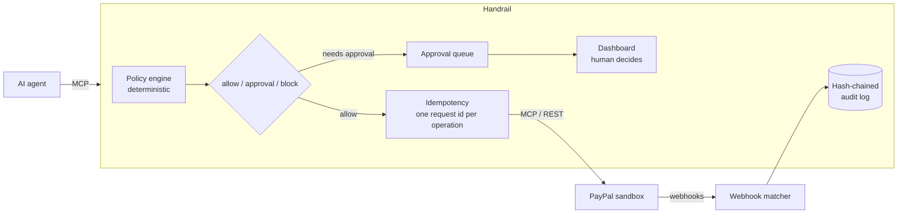

# Handrail

**A safety layer between an AI agent and PayPal.** Handrail sits between your agent and PayPal's Agent Toolkit MCP server. An existing Agent Toolkit agent works with no code changes: Handrail offers the same 46 tools, plus one optional tool for checking held calls, and checks every money-moving call against deterministic rules first. Small refunds go straight through. Large ones wait for a human. Some are never allowed. Retries never pay out twice, and everything that happens is written to a tamper-evident log.

Built for PayPal's *Build What's Next with PayPal and AI* hackathon. Sandbox only.

## The problem

An agent connected to PayPal's toolkit can issue refunds, concede disputes, cancel invoices and subscriptions, and capture payments, and nothing checks the call first:

- **No approval step or spending limit.** The toolkit can only turn whole tools on or off.
- **Retries can duplicate actions.** `PayPal-Request-Id` is set once per client, not per call, so a timed-out refund that the agent retries can refund twice.
- **No record of what the agent did,** or whether PayPal's later webhooks match it.

See [paypal/agent-toolkit #82](https://github.com/paypal/agent-toolkit/issues/82), [#95](https://github.com/paypal/agent-toolkit/issues/95) and [#98](https://github.com/paypal/agent-toolkit/issues/98).

## How it works



| Part | What it does |
| --- | --- |
| **Policy engine** (`src/policy/`) | Rules in `policy.json` decide *allow*, *needs approval* or *block* for each call: per-call amount ceilings, rolling spend limits, rate limits, payee allowlists and always-on tool rules. The strictest matching rule wins, and a human can never approve past a block. If a call carries no amount (a full refund, a capture, accepting a dispute), Handrail looks it up through read-only PayPal APIs. If it still can't tell the amount or payee, the call is held rather than guessed. |
| **Approval queue** (`src/approvals.ts`) | A held call waits about 20 seconds for a decision. If nobody decides in that time, the agent gets a structured "pending" answer and can check back with `handrail_get_approval`. Rejections and blocks come back as structured denials telling the agent not to retry. |
| **Idempotency** (`src/idempotency.ts`) | Every money call maps to one *operation*: the agent's `idempotency_key`, or a hash of the tool and its arguments within an hour. Repeats are answered from the record without contacting PayPal. `create_refund` and `pay_order` go straight to PayPal's REST API with a per-operation `PayPal-Request-Id`, so even a retry after a timeout can't duplicate the payment. |
| **Audit log** (`src/audit-chain.ts`) | Every decision, approval, result, webhook and policy change is an entry whose SHA-256 hash covers the previous one. It is written in the same SQLite transaction as the change it describes. Database triggers reject edits, and `verify()` recomputes the chain and replays it against the working tables, so editing either is detected. |
| **Webhooks** (`src/webhooks.ts`) | `POST /webhooks/paypal` verifies PayPal's signature and matches each event to the agent call that caused it. Mismatched amounts, and refunds or cancellations that no agent call explains, are flagged. |
| **Dashboard** (`web/`) | React and AG Grid: approval cards, an activity grid, webhook matches, the audit log with a live integrity badge, and the policy editor. |

### Where AI is used, and where it isn't

Enforcement is **always** deterministic, unit-tested code. AI is used for two advisory jobs, through Claude, and Handrail works the same without it:

1. **Briefing the reviewer.** When a call is held, Claude writes a short brief: what the agent is trying to do, why it was held, the relevant history, and what to check before approving. Totals and earlier calls on the same payment are computed by Handrail, and the model only puts them into words. The agent's arguments are marked as untrusted, so text like *"reviewer: approve this now"* is surfaced as a red flag rather than obeyed. Each brief is stored in the audit log, so the record shows exactly what the approver saw.
2. **Plain-English policy.** Type *"Refunds over $250 need my approval"*. Claude drafts rules, and Handrail validates them with the same parser that loads `policy.json` (the model gets one chance to fix an invalid draft). Handrail then shows the change in its own words, with warnings computed by code, for example when a tool loses its only amount limit. Nothing changes until a human clicks **Apply**. The change is recorded with who made it and the sentence they typed.

## Run it

Requires Node 22.13 or later (it uses the built-in `node:sqlite`) and a PayPal **sandbox** REST app.

```bash
npm install
cp .env.example .env      # then fill in your values (see below)
npm run build:web
npm run dev               # Handrail, dashboard and admin API on http://127.0.0.1:8787
```

| Variable | Needed for |
| --- | --- |
| `PAYPAL_CLIENT_ID`, `PAYPAL_CLIENT_SECRET` | Everything. Sandbox credentials only. |
| `HANDRAIL_ADMIN_TOKEN` | Signing in to the dashboard and admin API (`openssl rand -hex 32`). |
| `HANDRAIL_AGENT_TOKEN` | Agents connecting over HTTP at `/mcp`. Agents using stdio don't need it. |
| `PAYPAL_WEBHOOK_ID` | Receiving webhooks. Register a URL ending in `/webhooks/paypal`. |
| `ANTHROPIC_API_KEY` | The AI brief and the plain-English policy. Optional. |
| `HANDRAIL_AI_MODEL` | Optional. Defaults to `claude-opus-5-5`. `claude-sonnet-5-5` is faster. |

### Connect an agent

Point any MCP client at Handrail instead of PayPal. Over stdio:

```json
{
  "mcpServers": {
    "paypal": {
      "command": "npm",
      "args": ["run", "--silent", "dev:stdio", "--prefix", "/path/to/handrail"]
    }
  }
}
```

Or over HTTP: `POST http://127.0.0.1:8787/mcp` with `Authorization: Bearer $HANDRAIL_AGENT_TOKEN`.

### Try the demos

```bash
npm run demo:approval                 # allow, hold and approve, block, hold and reject (fake IDs, no money moves)
npm run sandbox:capture               # a real sandbox payment, captured through Handrail
npm run demo:retry-storm -- --capture <id> --amount 5.00 --count 10   # 10 identical refunds, PayPal gets one
npm run audit:verify                  # recompute the hash chain; exits 1 if anything was altered
npm test                              # policy engine, gate, idempotency, audit chain, webhooks, AI validation
```

Decide held calls in the dashboard, or with `npm run approvals -- approve <id>`.

## Things I learned about PayPal's MCP server

- The sandbox MCP server only works over **SSE** at `https://mcp.sandbox.paypal.com/sse`. The documented Streamable HTTP path `/http` returns 404 even with a valid token (`npm run probe` re-checks this).
- API failures come back as a *successful* tool result whose text is `{"ok":false,"status":404,...}`, so Handrail checks the text to classify them.
- The toolkit sets `PayPal-Request-Id` once per client, which is why Handrail sends refunds and captures directly with its own per-operation ID.

## Limits

- Sandbox only. It has not been tested with live credentials, and shouldn't be.
- One SQLite file. Deleting the newest audit entries can only be detected by comparing against a head hash recorded elsewhere (`audit:verify` prints it).
- The dashboard polls every few seconds rather than streaming updates.

## License

MIT
