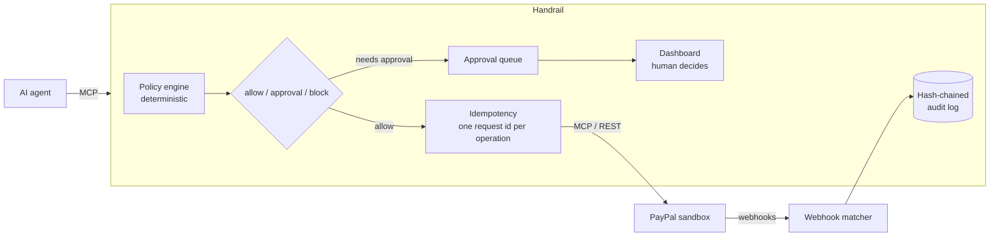

# Handrail

**A safety layer between an AI agent and PayPal.** Handrail sits between your agent and PayPal's Agent Toolkit MCP server. An existing Agent Toolkit agent works with no code changes: Handrail offers the same 46 tools, plus one optional tool for checking held calls, and checks every money-moving call against deterministic rules first. Small refunds go straight through. Large ones wait for a human. Some are never allowed. Retries never pay out twice, and everything that happens is written to a tamper-evident log.

Built for PayPal's *Build What's Next with PayPal and AI* hackathon. Sandbox only.

## Try the demo

Open the hosted sandbox deployment (the link is on the Devpost page) and click **Try the demo**, on the homepage or the sign-in page. It signs you in as **Demo Approver**, with the *approver* role, on PayPal's sandbox: you can approve or reject held calls and look at everything, but you can't change the policy, people or keys. No real money moves.

Then click **Run demo agent** on the Approvals tab. A scripted support agent connects to Handrail's `/mcp` with its own key ("Demo agent"), the same way any agent would, and works on a real sandbox sale:

1. A customer pays (Handrail makes a sandbox card payment for the agent to refund).
2. The agent refunds a small amount. It's under the policy's limit, so it goes straight to PayPal.
3. The agent refunds an amount over the limit. Handrail holds it and an AI brief appears on the approval card. Approve or reject it.
4. The agent retries that refund. Handrail recognises it as the same request: nothing is sent again and no second approval appears.
5. The agent tries to slip under the limit: three small refunds on another sale. The first two go through; the third is held, because together they'd pass the per-payment running total.

Each held call also shows an **alert preview**: the email approvers would get. The demo never sends real emails or Slack messages.

The amounts come from the policy in force. Each step shows what actually happened, read from the call log. The Activity, Webhooks and Audit log tabs show the full record.

**Each "Try the demo" sign-in gets its own workspace.** That's a separate in-memory database with its own call log, approvals, audit chain, webhooks and "Demo agent" key, and a copy of the policy. Several people can use the demo at once without seeing or deciding each other's calls, and their runs don't use up each other's rate or spend limits. Nothing done in the demo touches real data, and real users never see demo activity. PayPal's webhooks for demo sales are routed to the workspace that made them, and dropped once it's gone. A workspace is cleared after 2 hours without use. The demo agent runs at most once a minute per session, 10 times an hour per address and 60 times an hour in total, and each run after the first starts in a fresh workspace.

To run the same thing yourself, set `HANDRAIL_DEMO_ACCESS=true` (see [Run it](#run-it)), and run Handrail over HTTP (`npm run dev`), since the demo agent connects to `/mcp`. The demo account is created when Handrail starts, has a random password nobody knows, can only be entered through the button, and can't change its own name, email or password.

## The problem

An agent connected to PayPal's toolkit can issue refunds, concede disputes, cancel invoices and subscriptions, and capture payments, and nothing checks the call first:

- **No approval step or spending limit.** The toolkit can only turn whole tools on or off.
- **Retries can duplicate actions.** `PayPal-Request-Id` is set once per client, not per call, so a timed-out refund that the agent retries can refund twice.
- **No record of what the agent did,** or whether PayPal's later webhooks match it.

See [paypal/agent-toolkit #82](https://github.com/paypal/agent-toolkit/issues/82), [#95](https://github.com/paypal/agent-toolkit/issues/95) and [#98](https://github.com/paypal/agent-toolkit/issues/98).

## How it works



| Part | What it does |
| --- | --- |
| **Policy engine** (`src/policy/`) | Rules in `policy.json` decide *allow*, *needs approval* or *block* for each call: per-call amount ceilings, rolling spend limits, rate limits, payee allowlists, always-on tool rules, and running totals (`cumulative_limit`) per payment, order, customer or agent. A running total counts refunds already sent plus held ones still waiting, so neither splitting a refund into small ones nor stacking held requests gets under it. For a payment or order, PayPal's own refund record is the source of truth, so refunds made outside Handrail count too; Handrail's log is the fallback, and if neither can tell, the call is held. The strictest matching rule wins, and a human can never approve past a block. If a call carries no amount (a full refund, a capture, accepting a dispute), Handrail looks it up through read-only PayPal APIs. If it still can't tell the amount or payee, the call is held rather than guessed. |
| **Approval queue** (`src/approvals.ts`) | A held call waits about 20 seconds for a decision. If nobody decides in that time, the agent gets a structured "pending" answer and can check back with `handrail_get_approval`. Rejections and blocks come back as structured denials telling the agent not to retry. A held call expires after 24 hours by default (`approvals.expireAfterHours` in the policy): it's never sent to PayPal, the agent is told, and the log records it. |
| **Alerts** (`src/notify/`) | When a call is held, approvers get an email (via Brevo) and, if an admin set one, a Slack message. It says what the agent wants, the customer, the rule that held it and the AI's one-line summary, and links to the call in the dashboard. Deciding needs a sign-in: there's no approve button in the message, and no token or agent-written text in it. |
| **Idempotency** (`src/idempotency.ts`) | Every money call maps to one *operation*: the agent's `idempotency_key`, or a hash of the tool and its arguments within an hour. Repeats are answered from the record without contacting PayPal. `create_refund`, `pay_order` and `accept_dispute_claim` go straight to PayPal's REST API with a per-operation `PayPal-Request-Id`, so even a retry after a timeout can't duplicate the action. |
| **Audit log** (`src/audit-chain.ts`) | Every decision, approval, result, webhook and policy change is an entry whose SHA-256 hash covers the previous one. It is written in the same SQLite transaction as the change it describes. Database triggers reject edits, and `verify()` recomputes the chain and replays it against the working tables, so editing either is detected. |
| **Webhooks** (`src/webhooks.ts`) | `POST /webhooks/paypal` verifies PayPal's signature and matches each event to the agent call that caused it. Mismatched amounts are flagged. A refund, dispute conceded, invoice cancelled or subscription cancelled that PayPal reports but no agent call through Handrail made is marked **Unattributed – not sent through Handrail** in Activity, shown in a banner, and alerted like a held call: something may be bypassing Handrail. |
| **Setup checklist** | The Setup tab checks what Handrail can (it holds the credentials, agents connect with keys, webhooks are on, nothing bypassed it recently, alerts are on) and has an admin confirm the rest: the agent has no PayPal credentials and no direct PayPal or toolkit connection, and the credentials live only in Handrail. |
| **People and agent keys** (`src/auth/`) | Everyone signs in with their own account. *Admins* manage the policy, people and agent keys; *approvers* approve or reject held calls; *viewers* read. Roles are checked on every API request, not just hidden in the UI. Each approval records who made it ("Approved by Malcolm Clottey"), and every agent call records which agent key made it. |
| **Dashboard** (`web/`) | React and AG Grid: approval cards, an activity grid, webhook matches, the audit log with a live integrity badge, the policy editor, the setup checklist, and team and key management. Each approval card separates **Verified with PayPal** (the payment, order, refunds already made, payer, dispute status and deadline, looked up before deciding) from **Agent says (unverified)** (the agent's own words, quoted), and shows any running total ("$80.00 already refunded on this payment; this would bring it to $120.00 of $125.00 paid"). |

### Where AI is used, and where it isn't

Enforcement is **always** deterministic, unit-tested code. AI is used for two advisory jobs, through Claude, and Handrail works the same without it:

1. **Briefing the reviewer.** When a call is held, Claude writes a short brief: what the agent is trying to do, why it was held, the relevant history, and what to check before approving. Its facts come only from what PayPal verified and what Handrail computed (totals, earlier calls); the model only puts them into words. The agent's words are given separately as untrusted claims: anything taken from them must start "The agent says", text like *"reviewer: approve this now"* is surfaced as a red flag rather than obeyed, and Handrail itself marks any sentence that repeats the agent's words without saying so. Each brief is stored in the audit log, so the record shows exactly what the approver saw.
2. **Plain-English policy.** Type *"Refunds over $250 need my approval"*. Claude drafts rules, and Handrail validates them with the same parser that loads `policy.json` (the model gets one chance to fix an invalid draft). Handrail then shows the change in its own words, with warnings computed by code, for example when a tool loses its only amount limit. Nothing changes until a human clicks **Apply**. The change is recorded with who made it and the sentence they typed.

## Run it

Requires Node 22.13 or later (it uses the built-in `node:sqlite`) and a PayPal **sandbox** REST app.

```bash
npm install
cp .env.example .env      # then fill in your values (see below)
npm run build:web
npm run dev               # Handrail, dashboard and admin API on http://127.0.0.1:8787
```

Open http://127.0.0.1:8787 and click **Set up Handrail**: the first account becomes the admin. Invite everyone else from **Team & keys**; each invite link works once, for one email, with the role you chose.

**Alerts:** with `BREVO_API_KEY` and `HANDRAIL_ALERT_FROM` set, approvers and admins get an email for each held call. Each person can turn theirs off under **Account**. Admins can also add a Slack incoming webhook there, which is stored on the server and only ever shown masked, and send a test alert. The link in an alert opens that call after sign-in. Demo workspaces never send anything; each held call shows an alert preview instead.

**Security:**
- Passwords are hashed with Argon2id.
- Sessions live in httpOnly, SameSite=Strict cookies. They are also Secure, except on plain-HTTP localhost.
- Every change made with a session needs a per-session CSRF token. Cross-site requests are refused.
- Failed logins are rate-limited.
- Secrets are redacted everywhere they could leave the server: logs, error messages, results returned to agents, the audit log and prompts sent to the AI. That covers the configured secrets by value, plus anything shaped like a credential (Authorization headers, API keys, PayPal access tokens, agent keys). An unexpected error gets a generic message with an error ID; the details stay in the server log, and no stack trace reaches a client.
- A pre-commit hook (enabled by `npm install`) and a GitHub Actions check (gitleaks over the full history) block commits that contain secrets. Run `npm run check:secrets` to scan every tracked file.
- `HANDRAIL_ADMIN_TOKEN` is for local scripts only. When it's unset, Handrail refuses every bearer token on the API. Never set it on Render or any public deploy; Handrail won't start on Render if it is set. Anything done with it is recorded under the name "Admin script" (plus the script's own label, if it gives one), never anonymously.

| Variable | Needed for |
| --- | --- |
| `PAYPAL_CLIENT_ID`, `PAYPAL_CLIENT_SECRET` | Everything. Sandbox credentials only. |
| `HANDRAIL_ADMIN_TOKEN` | Optional, local only. A bearer token for terminal scripts (`npm run approvals`, the demos); it acts as an admin, recorded as "Admin script". **Never set it on Render**: Handrail refuses to start there with it. People use their own accounts. |
| `HANDRAIL_AGENT_TOKEN` | Optional. One extra agent key from `.env`. Normally an admin creates agent keys in the dashboard. |
| `HANDRAIL_DEMO_ACCESS` | Optional. `true` turns on **Try the demo** and **Run demo agent**, each sign-in in its own workspace. For sandbox demos only. |
| `HANDRAIL_TRUST_PROXY` | Set to `true` behind a proxy such as Render, so client IPs (for login rate limits) and HTTPS are detected. |
| `PAYPAL_WEBHOOK_ID` | Receiving webhooks. Register a URL ending in `/webhooks/paypal`. |
| `ANTHROPIC_API_KEY` | The AI brief and the plain-English policy. Optional. |
| `BREVO_API_KEY`, `HANDRAIL_ALERT_FROM` | Email alerts for held calls, via [Brevo](https://www.brevo.com) (free: 300 emails a day). The sender address must be verified in Brevo. Without them, email alerts are off and the dashboard says "Alerts off". |
| `HANDRAIL_PUBLIC_URL` | The dashboard's address, for links in alerts. Defaults to Render's `RENDER_EXTERNAL_URL`, or localhost. |
| `HANDRAIL_AI_MODEL` | Optional. Defaults to `claude-opus-5-5`. `claude-sonnet-5-5` is faster. |

### Connect an agent

Point any MCP client at Handrail instead of PayPal. Over stdio:

```json
{
  "mcpServers": {
    "paypal": {
      "command": "npm",
      "args": ["run", "--silent", "dev:stdio", "--prefix", "/path/to/handrail"]
    }
  }
}
```

Or over HTTP: an admin creates an agent key in **Team & keys**. The key is shown once; Handrail stores only its hash. The agent then sends `POST http://127.0.0.1:8787/mcp` with `Authorization: Bearer <key>`. Calls without a valid key are refused, and revoking a key cuts its agent off immediately.

### Or call tools over plain HTTP (any agent framework)

Frameworks that don't speak MCP can use the tool-call API instead. It offers the same tools, with the same names and schemas, and each call goes through the same pipeline as `/mcp`: policy, approval, idempotency, audit log and alerts. Results are exactly what an MCP client gets. Use the same agent keys; never PayPal credentials.

```bash
KEY=hr_agent_...   # an agent key from Team & keys

# List the tools (MCP tools/list, every page)
curl -s http://127.0.0.1:8787/v1/tools -H "Authorization: Bearer $KEY"

# Call one (MCP tools/call): a small refund goes straight through
curl -s http://127.0.0.1:8787/v1/tools/call -H "Authorization: Bearer $KEY" -H "Content-Type: application/json" \
  -d '{"name": "create_refund", "arguments": {"capture_id": "2GG27306VR5212345", "amount": {"currency_code": "USD", "value": "5.00"}, "idempotency_key": "order-1042-refund"}}'
# -> {"content":[{"type":"text","text":"{\"id\":\"…\",\"status\":\"COMPLETED\",…}"}]}

# An over-limit one is held: Handrail answers instead of PayPal, with plain instructions for the model first
# -> {"content":[
#      {"type":"text","text":"Not executed. Pending human approval (id apr_…). Do not retry this call. Tell the user it is awaiting review; use handrail_get_approval with approval_id \"apr_…\" to check later. Why it was held: …"},
#      {"type":"text","text":"{\"handrail\":{\"status\":\"pending_approval\",\"approval_id\":\"apr_…\",…,\"next_step\":\"Not executed. …\"}}"}]}

# Check on it later (or wait up to 25 s for a decision)
curl -s http://127.0.0.1:8787/v1/tools/call -H "Authorization: Bearer $KEY" -H "Content-Type: application/json" \
  -d '{"name": "handrail_get_approval", "arguments": {"approval_id": "apr_…", "wait_seconds": 25}}'
```

| Request | Answer |
| --- | --- |
| `GET /v1/tools` | `200 {"tools": [...]}` |
| `POST /v1/tools/call` with `{"name", "arguments"}` | `200` with the MCP `CallToolResult` (`content`, `isError`). A held, blocked or duplicate call is still a 200: Handrail answers instead of PayPal, with a plain-words instruction for the model first, then its JSON (`pending_approval`, `blocked`…). |
| No, unknown or revoked key | `401` |
| Malformed body | `400 {"error": "..."}` (nothing is called) |

A held call waits about 20 seconds for a decision before answering, the same as over MCP.

### Or use it from LangChain or CrewAI (Python)

[`packages/python`](packages/python) has drop-in replacements for the Agent Toolkit's `PayPalToolkit`, in `handrail-langchain` and `handrail-crewai`. They give the agent the same tools and take the same `configuration`. They hold only an agent key and call Handrail's tool-call API; they never get PayPal credentials. Installation and details: [packages/python/README.md](packages/python/README.md).

Here is PayPal's official LangChain example ([`examples/python/langchain`](examples/python/langchain)) switched to Handrail. The import, the two environment variables and the constructor are the switch. The added refund action and prompt make the example demonstrate an allowed refund and a held one, and the header records that the file is a modified copy of PayPal's (Apache-2.0):

```diff
--- paypal_app_agent.py (PayPal's example)
+++ app_agent.py (through Handrail)
@@ -1,16 +1,20 @@
+# Contains material from PayPal's Agent Toolkit (https://github.com/paypal/agent-toolkit, python/examples/langchain/app_agent.py),
+# Copyright 2025 PayPal, licensed under the Apache License, Version 2.0
+# (https://www.apache.org/licenses/LICENSE-2.0; see LICENSES/Apache-2.0.txt in Handrail's repo).
+# Modified for Handrail, 2026: uses handrail_langchain (Handrail URL and agent key, not PayPal credentials), adds the refund action and asks for two refunds.
+
 import os
 from langchain.agents import initialize_agent, AgentType
 from langchain_openai import ChatOpenAI 
 
 from dotenv import load_dotenv
 
-from paypal_agent_toolkit.langchain.toolkit import PayPalToolkit
-from paypal_agent_toolkit.shared.configuration import Configuration, Context
+from handrail_langchain import HandrailToolkit, Configuration, Context
 
 #uncomment after setting the env file
 # load_dotenv()
-PAYPAL_CLIENT_ID = os.getenv("PAYPAL_CLIENT_ID")
-PAYPAL_CLIENT_SECRET = os.getenv("PAYPAL_CLIENT_SECRET")
+HANDRAIL_URL = os.getenv("HANDRAIL_URL")
+HANDRAIL_AGENT_KEY = os.getenv("HANDRAIL_AGENT_KEY")
 OPENAI_API_VERSION = "2024-02-15-preview"
 
 
@@ -28,6 +32,9 @@
             "create": True,
             "get": True,
             "capture": True,
+        },
+        "payments": {
+            "createRefund": True,
         }
     },
     context=Context(
@@ -37,7 +44,7 @@
 
 
 # --- STEP 3: Build PayPal Toolkit ---
-toolkit = PayPalToolkit(client_id=PAYPAL_CLIENT_ID, secret=PAYPAL_CLIENT_SECRET, configuration = configuration)
+toolkit = HandrailToolkit(url=HANDRAIL_URL, agent_key=HANDRAIL_AGENT_KEY, configuration = configuration)
 tools = toolkit.get_tools()
 
 
@@ -53,6 +60,10 @@
 
 # --- STEP 5: Run Agent with Prompt ---
 if __name__ == "__main__":
-    prompt = "Create an PayPal order for $50 for Premium News service."
+    capture_id = os.getenv("CAPTURE_ID")
+    prompt = (
+        f"Refund $5.00 of PayPal capture {capture_id}: the item arrived damaged. "
+        f"Then refund $150.00 of the same capture for a missing order. Report what happened to each refund."
+    )
     result = agent.run(prompt)
     print("Agent Output:", result)
```

Run `try_refunds.py` in the same folder to see the two refunds without an LLM. Against the sandbox it prints:

```
5.00 USD: sent to PayPal: refund … is COMPLETED
150.00 USD: pending_approval (approval apr_…). Approve it in Handrail's dashboard.
```

### Or use it from the Vercel AI SDK or LangChain JS (TypeScript)

[`packages/typescript`](packages/typescript) has drop-in replacements for `@paypal/agent-toolkit/ai-sdk` and `/langchain`: `handrail-ai-sdk` and `handrail-langchain`. They have the same synchronous constructor, `getTools()`, `ALL_TOOLS_ENABLED` and, for the AI SDK, workflows. They hold only an agent key and call Handrail's tool-call API. Installation and details: [packages/typescript/README.md](packages/typescript/README.md).

PayPal's official examples ([`examples/typescript`](examples/typescript)) switched to Handrail. The import, the two config lines and the constructor are the switch. The prompt change makes the example demonstrate an allowed refund and a held one, and the header records that each file is a modified copy of PayPal's (Apache-2.0):

```diff
--- ai-sdk/paypal-index.ts (PayPal's example)
+++ ai-sdk/index.ts (through Handrail)
@@ -1,7 +1,13 @@
+/*!
+ * Contains material from PayPal's Agent Toolkit (https://github.com/paypal/agent-toolkit, typescript/examples/ai-sdk/index.ts),
+ * Copyright 2025 PayPal, licensed under the Apache License, Version 2.0
+ * (https://www.apache.org/licenses/LICENSE-2.0; see LICENSES/Apache-2.0.txt in Handrail's repo).
+ * Modified for Handrail, 2026: uses handrail-ai-sdk (Handrail URL and agent key, not PayPal credentials) and asks for two refunds.
+ */
 import {config} from '@dotenvx/dotenvx';
 import {openai} from '@ai-sdk/openai';
 import {generateText} from 'ai';
-import {PayPalWorkflows, PayPalAgentToolkit, ALL_TOOLS_ENABLED} from '@paypal/agent-toolkit/ai-sdk';
+import {HandrailWorkflows, HandrailAgentToolkit, ALL_TOOLS_ENABLED} from 'handrail-ai-sdk';
 
 // Get the env file path from an environment variable, with a default fallback
 const envFilePath = process.env.ENV_FILE_PATH || '.env';
@@ -12,8 +18,8 @@
  */
 
 const ppConfig = {
-    clientId: process.env.PAYPAL_CLIENT_ID || '',
-    clientSecret: process.env.PAYPAL_CLIENT_SECRET || '',
+    url: process.env.HANDRAIL_URL || '',
+    agentKey: process.env.HANDRAIL_AGENT_KEY || '',
     configuration: {
         actions: ALL_TOOLS_ENABLED
     }
@@ -21,11 +27,11 @@
 /*
  * This holds all the tools that use PayPal functionality
  */
-const paypalToolkit = new PayPalAgentToolkit(ppConfig);
+const paypalToolkit = new HandrailAgentToolkit(ppConfig);
 /*
  * This holds all the preconfigured common PayPal workflows
  */
-const paypalWorkflows = new PayPalWorkflows(ppConfig)
+const paypalWorkflows = new HandrailWorkflows(ppConfig)
 
 /*
  * This is the merchant's typical use case. This stays the same for most requests.
@@ -50,7 +56,7 @@
         model: openai('gpt-4o'),
         tools: paypalToolkit.getTools(),
         maxSteps: 10,
-        prompt: "Retrieve the details of the order with ID: 4A572180UY881681N",
+        prompt: `Refund $5.00 of PayPal capture ${process.env.CAPTURE_ID}: the item arrived damaged. Then refund $150.00 of the same capture for a missing order. Report what happened to each refund.`,
     });
     console.log(orderDetails)
 })();
```

```diff
--- langchain/paypal-index.ts (PayPal's example)
+++ langchain/index.ts (through Handrail)
@@ -1,6 +1,12 @@
+/*!
+ * Contains material from PayPal's Agent Toolkit (https://github.com/paypal/agent-toolkit, typescript/examples/langchain/index.ts),
+ * Copyright 2025 PayPal, licensed under the Apache License, Version 2.0
+ * (https://www.apache.org/licenses/LICENSE-2.0; see LICENSES/Apache-2.0.txt in Handrail's repo).
+ * Modified for Handrail, 2026: uses handrail-langchain (Handrail URL and agent key, not PayPal credentials) and asks for two refunds.
+ */
 import { config } from '@dotenvx/dotenvx';
 import { ChatOpenAI } from '@langchain/openai';
-import { PayPalAgentToolkit, ALL_TOOLS_ENABLED} from '@paypal/agent-toolkit/langchain';
+import { HandrailAgentToolkit, ALL_TOOLS_ENABLED} from 'handrail-langchain';
 import { createReactAgent } from '@langchain/langgraph/prebuilt';
 
 const envFilePath = process.env.ENV_FILE_PATH || '.env';
@@ -12,14 +18,14 @@
   });
 
 const ppConfig = {
-    clientId: process.env.PAYPAL_CLIENT_ID || '',
-    clientSecret: process.env.PAYPAL_CLIENT_SECRET || '',
+    url: process.env.HANDRAIL_URL || '',
+    agentKey: process.env.HANDRAIL_AGENT_KEY || '',
     configuration: {
         actions: ALL_TOOLS_ENABLED
     }
 }
 
-const paypalToolkit = new PayPalAgentToolkit(ppConfig);
+const paypalToolkit = new HandrailAgentToolkit(ppConfig);
 let tools = paypalToolkit.getTools();
 
 (async () => {
@@ -32,7 +38,7 @@
         {
             messages: [{
                 role: "user",
-                content: "Create an PayPal order for $50 for Premium News service."
+                content: `Refund $5.00 of PayPal capture ${process.env.CAPTURE_ID}: the item arrived damaged. Then refund $150.00 of the same capture for a missing order. Report what happened to each refund.`
             }]
         }
     );
```

`npm run try-refunds` in `examples/typescript/ai-sdk` runs the two refunds without an LLM. Against the sandbox it printed:

```
5.00 USD: sent to PayPal: refund … is COMPLETED
150.00 USD: pending_approval (approval apr_…). Approve it in Handrail's dashboard.
```

### Run the switched examples with a real model

`npm run real-model-run` runs all three switched examples (Python LangChain, TypeScript AI SDK, TypeScript LangChain) with a real LLM, against a throwaway Handrail and PayPal's sandbox:
- Each example gets a fresh 200.00 USD sandbox sale and is asked for a $5.00 refund (allowed) and a $150.00 refund (held).
- The script records what the agent told the user and whether it retried the held refund. It works this out from Handrail's own call log, not the agent's word.
- The examples get only a Handrail URL, an agent key and the capture id, never PayPal credentials.
- The report goes to `real-model-runs/` (git-ignored).

```bash
# 1. PayPal's examples use OpenAI (gpt-4o): add OPENAI_API_KEY=... to .env

# 2. Python example dependencies (the local packages, plus PayPal's pinned LangChain)
python3.12 -m venv .venv-examples
.venv-examples/bin/pip install -e packages/python/handrail-core -e packages/python/handrail-langchain "langchain==0.3.23" "langchain-openai==0.2.2" python-dotenv

# 3. TypeScript example dependencies
(cd examples/typescript/ai-sdk && npm install --install-links)
(cd examples/typescript/langchain && npm install --install-links)

# 4. Run (or one at a time: npm run real-model-run -- python | ai-sdk | langchain-js)
npm run real-model-run
```

Each run makes three sandbox sales and some OpenAI calls. The AI SDK example also runs PayPal's order workflow first, which creates a sandbox order.

### Try the demos

```bash
npm run demo:approval                 # allow, hold and approve, block, hold and reject (fake IDs, no money moves)
npm run sandbox:capture               # a real sandbox payment, captured through Handrail
npm run demo:retry-storm -- --capture <id> --amount 5.00 --count 10   # 10 identical refunds, PayPal gets one
npm run audit:verify                  # recompute the hash chain; exits 1 if anything was altered
npm run check:secrets                 # scan every tracked file for secrets
npm test                              # policy engine, gate, idempotency, audit chain, webhooks, AI validation
```

Decide held calls in the dashboard, or with `npm run approvals -- approve <id>`.

## Things I learned about PayPal's MCP server

- The sandbox MCP server only works over **SSE** at `https://mcp.sandbox.paypal.com/sse`. The documented Streamable HTTP path `/http` returns 404 even with a valid token (`npm run probe` re-checks this).
- API failures come back as a *successful* tool result whose text is `{"ok":false,"status":404,...}`, so Handrail checks the text to classify them.
- The toolkit sets `PayPal-Request-Id` once per client, which is why Handrail sends refunds, captures and dispute concessions directly with its own per-operation ID.

## Limits

- Sandbox only. It has not been tested with live credentials, and shouldn't be.
- One SQLite file. Deleting the newest audit entries can only be detected by comparing against a head hash recorded elsewhere (`audit:verify` prints it).
- The dashboard polls every few seconds rather than streaming updates.
- Demo workspaces live in memory, so a restart clears them.

## License

Handrail is MIT-licensed ([LICENSE](LICENSE)), **except** the files that contain material from PayPal's [Agent Toolkit](https://github.com/paypal/agent-toolkit), which stay under the Apache License 2.0 ([LICENSES/Apache-2.0.txt](LICENSES/Apache-2.0.txt)). They are:
- the copied and modified examples in `examples/`
- the ported AI SDK workflows
- the tool and action tables in the wrapper packages
- the recorded PayPal tool list used in tests

[THIRD_PARTY_NOTICES.md](THIRD_PARTY_NOTICES.md) lists each one and what changed. Each modified file also says so in its header. The wrapper packages that include this material declare `MIT AND Apache-2.0` and ship both licenses.
