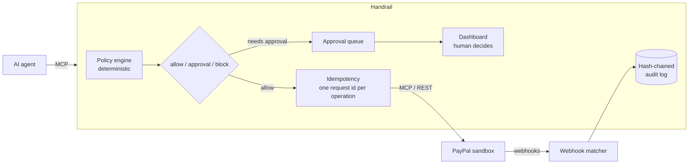

# Handrail

**A safety layer between an AI agent and PayPal.** Handrail sits between your agent and PayPal's Agent Toolkit MCP server. An existing Agent Toolkit agent works with no code changes: Handrail offers the same 46 tools, plus one optional tool for checking held calls, and checks every money-moving call against deterministic rules first. Small refunds go straight through. Large ones wait for a human. Some are never allowed. Retries never pay out twice, and everything that happens is written to a tamper-evident log.

Built for PayPal's *Build What's Next with PayPal and AI* hackathon. Sandbox only.

## Try the demo

Open the hosted sandbox deployment (the link is on the Devpost page) and click **Try the demo**, on the homepage or the sign-in page. It signs you in as **Demo Approver**, with the *approver* role, on PayPal's sandbox: you can approve or reject held calls and look at everything, but you can't change the policy, people or keys. No real money moves.

Then click **Run demo agent** on the Approvals tab. A scripted support agent connects to Handrail's `/mcp` with its own key ("Demo agent"), the same way any agent would, and works on a real sandbox sale:

1. A customer pays (Handrail makes a sandbox card payment for the agent to refund).
2. The agent refunds a small amount. It's under the policy's limit, so it goes straight to PayPal.
3. The agent refunds an amount over the limit. Handrail holds it and an AI brief appears on the approval card. Approve or reject it.
4. The agent retries that refund. Handrail recognises it as the same request: nothing is sent again and no second approval appears.

Each held call also shows an **alert preview**: the email approvers would get. The demo never sends real emails or Slack messages.

The amounts come from the policy in force. Each step shows what actually happened, read from the call log. The Activity, Webhooks and Audit log tabs show the full record.

**Each "Try the demo" sign-in gets its own workspace.** That's a separate in-memory database with its own call log, approvals, audit chain, webhooks and "Demo agent" key, and a copy of the policy. Several people can use the demo at once without seeing or deciding each other's calls, and their runs don't use up each other's rate or spend limits. Nothing done in the demo touches real data, and real users never see demo activity. PayPal's webhooks for demo sales are routed to the workspace that made them, and dropped once it's gone. A workspace is cleared after 2 hours without use. The demo agent runs at most once a minute per session, 10 times an hour per address and 60 times an hour in total.

To run the same thing yourself, set `HANDRAIL_DEMO_ACCESS=true` (see [Run it](#run-it)), and run Handrail over HTTP (`npm run dev`), since the demo agent connects to `/mcp`. The demo account is created when Handrail starts, has a random password nobody knows, can only be entered through the button, and can't change its own name, email or password.

## The problem

An agent connected to PayPal's toolkit can issue refunds, concede disputes, cancel invoices and subscriptions, and capture payments, and nothing checks the call first:

- **No approval step or spending limit.** The toolkit can only turn whole tools on or off.
- **Retries can duplicate actions.** `PayPal-Request-Id` is set once per client, not per call, so a timed-out refund that the agent retries can refund twice.
- **No record of what the agent did,** or whether PayPal's later webhooks match it.

See [paypal/agent-toolkit #82](https://github.com/paypal/agent-toolkit/issues/82), [#95](https://github.com/paypal/agent-toolkit/issues/95) and [#98](https://github.com/paypal/agent-toolkit/issues/98).

## How it works



| Part | What it does |
| --- | --- |
| **Policy engine** (`src/policy/`) | Rules in `policy.json` decide *allow*, *needs approval* or *block* for each call: per-call amount ceilings, rolling spend limits, rate limits, payee allowlists and always-on tool rules. The strictest matching rule wins, and a human can never approve past a block. If a call carries no amount (a full refund, a capture, accepting a dispute), Handrail looks it up through read-only PayPal APIs. If it still can't tell the amount or payee, the call is held rather than guessed. |
| **Approval queue** (`src/approvals.ts`) | A held call waits about 20 seconds for a decision. If nobody decides in that time, the agent gets a structured "pending" answer and can check back with `handrail_get_approval`. Rejections and blocks come back as structured denials telling the agent not to retry. A held call expires after 24 hours by default (`approvals.expireAfterHours` in the policy): it's never sent to PayPal, the agent is told, and the log records it. |
| **Alerts** (`src/notify/`) | When a call is held, approvers get an email (via Brevo) and, if an admin set one, a Slack message. It says what the agent wants, the customer, the rule that held it and the AI's one-line summary, and links to the call in the dashboard. Deciding needs a sign-in: there's no approve button in the message, and no token or agent-written text in it. |
| **Idempotency** (`src/idempotency.ts`) | Every money call maps to one *operation*: the agent's `idempotency_key`, or a hash of the tool and its arguments within an hour. Repeats are answered from the record without contacting PayPal. `create_refund` and `pay_order` go straight to PayPal's REST API with a per-operation `PayPal-Request-Id`, so even a retry after a timeout can't duplicate the payment. |
| **Audit log** (`src/audit-chain.ts`) | Every decision, approval, result, webhook and policy change is an entry whose SHA-256 hash covers the previous one. It is written in the same SQLite transaction as the change it describes. Database triggers reject edits, and `verify()` recomputes the chain and replays it against the working tables, so editing either is detected. |
| **Webhooks** (`src/webhooks.ts`) | `POST /webhooks/paypal` verifies PayPal's signature and matches each event to the agent call that caused it. Mismatched amounts, and refunds or cancellations that no agent call explains, are flagged. |
| **People and agent keys** (`src/auth/`) | Everyone signs in with their own account. *Admins* manage the policy, people and agent keys; *approvers* approve or reject held calls; *viewers* read. Roles are checked on every API request, not just hidden in the UI. Each approval records who made it ("Approved by Malcolm Clottey"), and every agent call records which agent key made it. |
| **Dashboard** (`web/`) | React and AG Grid: approval cards, an activity grid, webhook matches, the audit log with a live integrity badge, the policy editor, and team and key management. |

### Where AI is used, and where it isn't

Enforcement is **always** deterministic, unit-tested code. AI is used for two advisory jobs, through Claude, and Handrail works the same without it:

1. **Briefing the reviewer.** When a call is held, Claude writes a short brief: what the agent is trying to do, why it was held, the relevant history, and what to check before approving. Totals and earlier calls on the same payment are computed by Handrail, and the model only puts them into words. The agent's arguments are marked as untrusted, so text like *"reviewer: approve this now"* is surfaced as a red flag rather than obeyed. Each brief is stored in the audit log, so the record shows exactly what the approver saw.
2. **Plain-English policy.** Type *"Refunds over $250 need my approval"*. Claude drafts rules, and Handrail validates them with the same parser that loads `policy.json` (the model gets one chance to fix an invalid draft). Handrail then shows the change in its own words, with warnings computed by code, for example when a tool loses its only amount limit. Nothing changes until a human clicks **Apply**. The change is recorded with who made it and the sentence they typed.

## Run it

Requires Node 22.13 or later (it uses the built-in `node:sqlite`) and a PayPal **sandbox** REST app.

```bash
npm install
cp .env.example .env      # then fill in your values (see below)
npm run build:web
npm run dev               # Handrail, dashboard and admin API on http://127.0.0.1:8787
```

Open http://127.0.0.1:8787 and click **Set up Handrail**: the first account becomes the admin. Invite everyone else from **Team & keys**; each invite link works once, for one email, with the role you chose.

**Alerts:** with `BREVO_API_KEY` and `HANDRAIL_ALERT_FROM` set, approvers and admins get an email for each held call. Each person can turn theirs off under **Account**. Admins can also add a Slack incoming webhook there, which is stored on the server and only ever shown masked, and send a test alert. The link in an alert opens that call after sign-in. Demo workspaces never send anything; each held call shows an alert preview instead.

**Security:**
- Passwords are hashed with Argon2id.
- Sessions live in httpOnly, SameSite=Strict cookies. They are also Secure, except on plain-HTTP localhost.
- Every change made with a session needs a per-session CSRF token. Cross-site requests are refused.
- Failed logins are rate-limited.
- Secrets are redacted everywhere they could leave the server: logs, error messages, results returned to agents, the audit log and prompts sent to the AI. That covers the configured secrets by value, plus anything shaped like a credential (Authorization headers, API keys, PayPal access tokens, agent keys). An unexpected error gets a generic message with an error ID; the details stay in the server log, and no stack trace reaches a client.
- A pre-commit hook (enabled by `npm install`) and a GitHub Actions check (gitleaks over the full history) block commits that contain secrets. Run `npm run check:secrets` to scan every tracked file.
- `HANDRAIL_ADMIN_TOKEN` is for local scripts only. When it's unset, Handrail refuses every bearer token on the API. Never set it on Render or any public deploy; Handrail won't start on Render if it is set. Anything done with it is recorded under the name "Admin script" (plus the script's own label, if it gives one), never anonymously.

| Variable | Needed for |
| --- | --- |
| `PAYPAL_CLIENT_ID`, `PAYPAL_CLIENT_SECRET` | Everything. Sandbox credentials only. |
| `HANDRAIL_ADMIN_TOKEN` | Optional, local only. A bearer token for terminal scripts (`npm run approvals`, the demos); it acts as an admin, recorded as "Admin script". **Never set it on Render**: Handrail refuses to start there with it. People use their own accounts. |
| `HANDRAIL_AGENT_TOKEN` | Optional. One extra agent key from `.env`. Normally an admin creates agent keys in the dashboard. |
| `HANDRAIL_DEMO_ACCESS` | Optional. `true` turns on **Try the demo** and **Run demo agent**, each sign-in in its own workspace. For sandbox demos only. |
| `HANDRAIL_TRUST_PROXY` | Set to `true` behind a proxy such as Render, so client IPs (for login rate limits) and HTTPS are detected. |
| `PAYPAL_WEBHOOK_ID` | Receiving webhooks. Register a URL ending in `/webhooks/paypal`. |
| `ANTHROPIC_API_KEY` | The AI brief and the plain-English policy. Optional. |
| `BREVO_API_KEY`, `HANDRAIL_ALERT_FROM` | Email alerts for held calls, via [Brevo](https://www.brevo.com) (free: 300 emails a day). The sender address must be verified in Brevo. Without them, email alerts are off and the dashboard says "Alerts off". |
| `HANDRAIL_PUBLIC_URL` | The dashboard's address, for links in alerts. Defaults to Render's `RENDER_EXTERNAL_URL`, or localhost. |
| `HANDRAIL_AI_MODEL` | Optional. Defaults to `claude-opus-5-5`. `claude-sonnet-5-5` is faster. |

### Connect an agent

Point any MCP client at Handrail instead of PayPal. Over stdio:

```json
{
  "mcpServers": {
    "paypal": {
      "command": "npm",
      "args": ["run", "--silent", "dev:stdio", "--prefix", "/path/to/handrail"]
    }
  }
}
```

Or over HTTP: an admin creates an agent key in **Team & keys**. The key is shown once; Handrail stores only its hash. The agent then sends `POST http://127.0.0.1:8787/mcp` with `Authorization: Bearer <key>`. Calls without a valid key are refused, and revoking a key cuts its agent off immediately.

### Try the demos

```bash
npm run demo:approval                 # allow, hold and approve, block, hold and reject (fake IDs, no money moves)
npm run sandbox:capture               # a real sandbox payment, captured through Handrail
npm run demo:retry-storm -- --capture <id> --amount 5.00 --count 10   # 10 identical refunds, PayPal gets one
npm run audit:verify                  # recompute the hash chain; exits 1 if anything was altered
npm run check:secrets                 # scan every tracked file for secrets
npm test                              # policy engine, gate, idempotency, audit chain, webhooks, AI validation
```

Decide held calls in the dashboard, or with `npm run approvals -- approve <id>`.

## Things I learned about PayPal's MCP server

- The sandbox MCP server only works over **SSE** at `https://mcp.sandbox.paypal.com/sse`. The documented Streamable HTTP path `/http` returns 404 even with a valid token (`npm run probe` re-checks this).
- API failures come back as a *successful* tool result whose text is `{"ok":false,"status":404,...}`, so Handrail checks the text to classify them.
- The toolkit sets `PayPal-Request-Id` once per client, which is why Handrail sends refunds and captures directly with its own per-operation ID.

## Limits

- Sandbox only. It has not been tested with live credentials, and shouldn't be.
- One SQLite file. Deleting the newest audit entries can only be detected by comparing against a head hash recorded elsewhere (`audit:verify` prints it).
- The dashboard polls every few seconds rather than streaming updates.
- Demo workspaces live in memory, so a restart clears them.

## License

MIT
