# Handrail UI inventory

A complete description of the UI as of Oct 14, 2026 (commit `8beb963`), for planning a redesign. Nothing here changes code. Regenerated from scratch: every screen was re-checked and every screenshot retaken.

**[New]** marks what's new or changed since the previous inventory (Oct 13, commit `c31c97d`). The new items are:
- the homepage: nav links, hero wording, "What Handrail does", "Works with the agent you have" with framework diff tabs, and the "Try the demo" band (§2.1);
- the plain-words instruction for the model, now shown in the Activity drawer's "Result returned to the agent" (§5);
- new shared pieces and inconsistencies (§16–18).

The rest of the dashboard (Setup, connect guide, alert settings, Team & keys, demo panel) is unchanged since then. It's re-described here in full.

**Screenshots** are in [`docs/ui-screens/`](ui-screens/), light mode unless noted. They show the real built UI (`web/dist`) with **made-up data**: the `/api` responses were replaced by fixtures in the browser, so every name, email (`example.com`), PayPal id and hash is invented. Nothing comes from a real sandbox account.

Source: `web/src/` (React 19 + AG Grid 34, no UI framework). Styles are one file, `web/src/styles.css`. AG Grid themes are in `web/src/grid.ts`.

---

## Contents

1. [Global behaviour](#1-global-behaviour)
2. [Public pages](#2-public-pages): Home, Sign in, Sign up / invite
3. [Dashboard shell](#3-dashboard-shell): header, banners, stats, tabs
4. [Approvals tab](#4-approvals-tab) (incl. demo agent panel)
5. [Activity tab](#5-activity-tab)
6. [Webhooks tab](#6-webhooks-tab)
7. [Audit log tab](#7-audit-log-tab)
8. [Policy tab](#8-policy-tab)
9. [Setup tab](#9-setup-tab)
10. [Team & keys tab](#10-team--keys-tab) (admin only)
11. [Account](#11-account)
12. [Demo-mode differences](#12-demo-mode-differences)
13. [Responsive behaviour](#13-responsive-behaviour)
14. [Light and dark mode](#14-light-and-dark-mode)
15. [Navigation map](#15-navigation-map)
16. [Design tokens in use](#16-design-tokens-in-use)
17. [Shared components](#17-shared-components)
18. [Inconsistencies noticed](#18-inconsistencies-noticed)

---

## 1. Global behaviour

| Topic | Behaviour |
| --- | --- |
| Routing | Client-side, `web/src/router.ts`. Paths: `/`, `/login`, `/signup`, `/app`. Anything else falls through to the Home page. Dashboard tabs are the URL hash: `/app#activity`, etc. `/app#approvals/<id>` opens Approvals focused on one approval (links in alert emails). |
| Auth gate | `/app` signed out → redirect to `/login?next=/app<hash>`, which returns there after sign-in. `/login` or `/signup` while signed in → redirect to `/app` (or `next`). |
| Session | httpOnly cookie; the UI keeps the user and CSRF token from `GET /api/auth/session`. Any 401 fires `handrail:signed-out` and re-checks the session. |
| Initial load | Before the session loads: centered "Loading…" (muted). If the API is unreachable: "Can't reach Handrail: <error>" (red). |
| Live updates | Polling only (`usePoll`), paused while the tab is hidden: approvals 2 s (pending) / 5 s (all), summary 3 s, audit verify 10 s, activity calls 3 s, unattributed 10 s, webhooks 4 s, audit 4 s, policy 15 s, setup 15 s, users 10 s, invites 15 s, agent keys 10 s, alert settings 30 s, demo run 1.5 s. No websockets. |
| Document title | "Handrail", or "(N) Handrail" while N calls wait for approval. |
| Favicon | `/handrail-logo.png` (also apple-touch-icon). `theme-color` #127842. |
| Theme | Light by default; a ☾/☀ toggle switches to dark, stored in `localStorage` (`handrail.theme`). It doesn't follow the OS setting. |
| Toasts | None. Feedback is inline text (`.outcome` lines, `.error` paragraphs, `.notice` boxes). |
| Confirmation dialogs | Native `window.confirm` only: removing a policy rule, revoking an agent key, removing the Slack webhook. Native `window.alert` shows a policy-removal error. |
| Modals/drawers | One drawer pattern (right side, 620 px max, backdrop click or Esc closes): Activity call, Activity unattributed event, Audit entry. No modals. |

---

## 2. Public pages

### 2.1 Home: `/`

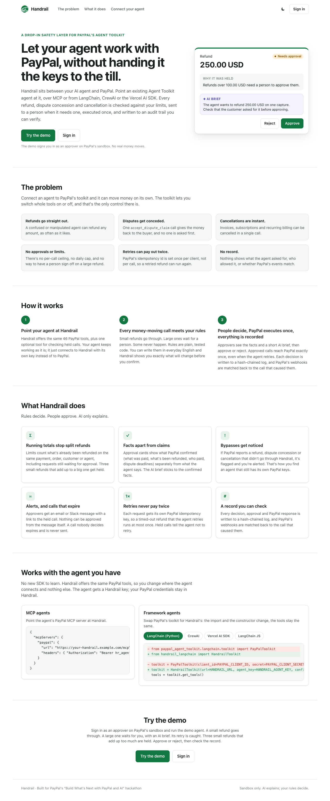 · Framework tab: [01b-home-connect-ai-sdk-tab.png](ui-screens/01b-home-connect-ai-sdk-tab.png) · Phone: [23-phone-home.png](ui-screens/23-phone-home.png)

- **Reached by:** opening the site; the logo/brand in any header; any unknown path; "Sign out" (navigates here).
- **Who:** everyone. Signed-in users see "Open the dashboard" / "Dashboard" instead of the sign-in actions.

**Layout, top to bottom**

1. **Nav bar** (`.home-nav`):
   - Left: logo (28 px) + "Handrail".
   - Middle: in-page links "The problem" (#problem), **[New]** "What it does" (#features) and **[New]** "Connect your agent" (#connect). "How it works" no longer has a nav link, though the section is still there.
   - Right: theme toggle (☾/☀), plus "Sign in" (secondary, → /login) or, when signed in, "Dashboard" (→ /app).
2. **Hero** (two columns):
   - Kicker: "A DROP-IN SAFETY LAYER FOR PAYPAL'S AGENT TOOLKIT" (green, uppercase).
   - H1: "Let your agent work with PayPal, without handing it the keys to the till."
   - **[New]** Lede: "Handrail sits between your AI agent and PayPal. Point an existing Agent Toolkit agent at it, over MCP or from LangChain, CrewAI or the Vercel AI SDK. Every refund, dispute concession and cancellation is checked against your limits, sent to a person when it needs one, executed once, and written to an audit trail you can verify."
   - Actions, signed out:
     - "Try the demo" (primary, large; only when demo access is on; busy state "Opening the demo…")
     - "Sign in" (secondary; primary if the demo is off). It reads "Set up Handrail" and goes to /signup when no account exists yet.
   - Actions, signed in: "Open the dashboard".
   - Fine print (demo on, signed out): "The demo signs you in as an approver on PayPal's sandbox. No real money moves."
   - Demo sign-in error: red text under the actions.
   - Right column: **Hero card** (decorative, `aria-hidden`), a fake approval card:
     - "Refund" with "250.00 USD" and a "Needs approval" pill
     - "WHY IT WAS HELD": "Refunds over 100.00 USD need a person to approve them."
     - "✦ AI BRIEF": "The agent wants to refund 250.00 USD on one capture. Check that the customer asked for it before approving."
     - Fake "Reject" / "Approve" buttons (spans)
     - A green top border
3. **"The problem"** (#problem). Lede: "Connect an agent to PayPal's toolkit and it can move money on its own. The toolkit lets you switch whole tools on or off, and that's the only control there is." Then 6 tiles (3×2 grid, grey `surface-2` fill):
   - "Refunds go straight out."
   - "Disputes get conceded." (with `accept_dispute_claim` in mono)
   - "Cancellations are instant."
   - "No approvals or limits."
   - "Retries can pay out twice."
   - "No record."
4. **"How it works"** (#how). Three numbered steps in green circles:
   - (1) "Point your agent at Handrail"
   - (2) "Every money-moving call meets your rules"
   - (3) "People decide, PayPal executes once, everything is recorded"
   - Each has a paragraph; see the screenshot.
5. **[New] "What Handrail does"** (#features). Lede: "Rules decide. People approve. AI only explains." Then 6 feature cards (3×2 grid on white surface, shadow). Each has a 34 px icon tile in brand tint, with a text glyph:

   | Glyph | Card title | Text |
   | --- | --- | --- |
   | Σ | "Running totals stop split refunds" | Limits count what's already been refunded on the same payment, order, customer or agent, including requests still waiting; three small refunds that add up get held. |
   | ✓ | "Facts apart from claims" | Approval cards show what PayPal confirmed separately from what the agent says; the AI brief sticks to the confirmed facts. |
   | ! | "Bypasses get noticed" | Refunds, dispute concessions or cancellations that didn't go through Handrail are flagged and alerted. |
   | ✉ | "Alerts, and calls that expire" | Email or Slack with a link; nothing can be approved from the message; undecided calls expire. |
   | 1× | "Retries never pay twice" | A per-request idempotency key; held calls tell the agent not to retry. |
   | # | "A record you can check" | Hash-chained log; webhooks matched back to calls. |

6. **[New] "Works with the agent you have"** (#connect).
   - Lede: "No new SDK to learn. Handrail offers the same PayPal tools, so you change where the agent connects and nothing else. The agent gets a Handrail key; your PayPal credentials stay in Handrail."
   - Two cards side by side (40/60 split):
     - **"MCP agents"**: "Point the agent's PayPal MCP server at Handrail.", followed by a JSON code block (`mcpServers.paypal` with `url` "https://your-handrail.example.com/mcp" and an `Authorization: Bearer hr_agent_…` header).
     - **"Framework agents"**: "Swap PayPal's toolkit for Handrail's: the import and the constructor change, the tools stay the same."
   - **Tabs** (pill buttons, `role=tab`): "LangChain (Python)" (default), "CrewAI", "Vercel AI SDK", "LangChain JS". The selected tab is filled green.
   - **Diff block:** a monospace before/after for the selected tab. Removed lines (−, red on `--bad-bg`) are PayPal's import and constructor; added lines (+, green on `--brand-tint`) are Handrail's; one unchanged context line follows (`tools = toolkit.get_tools()`, `await generateText(…)`, etc.).
   - Long lines scroll sideways inside the block.
7. **[New] CTA band "Try the demo"** (was "See it on the sandbox"):
   - "Sign in as an approver on PayPal's sandbox and run the demo agent. A small refund goes through. A large one waits for you, with an AI brief. Its retry is caught. Three small refunds that add up too much are held. Approve or reject, then check the record."
   - The same actions as the hero.
8. **Footer**: left "Handrail · Built for PayPal's "Build What's Next with PayPal and AI" hackathon", right "Sandbox only. AI explains; your rules decide."

**States:**
- Demo busy: the button is disabled and reads "Opening the demo…".
- Demo error: red text under the actions.
- **[New]** The selected framework tab is local state; it resets on reload.

### 2.2 Sign in: `/login`

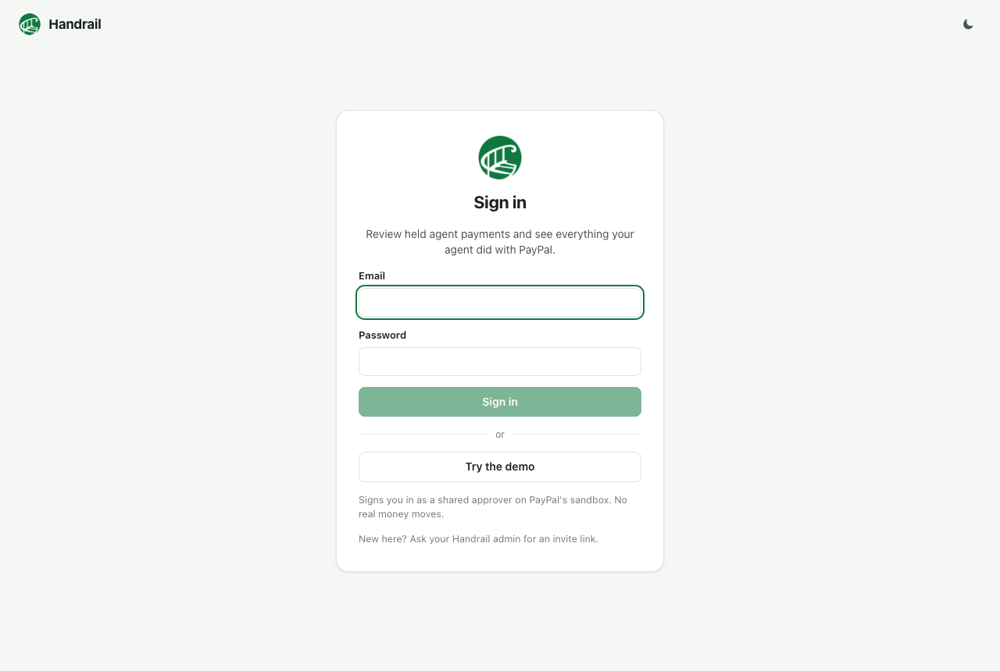 · From an alert link: 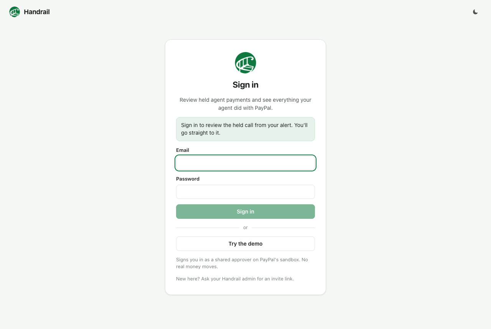

- **Reached by:**
  - "Sign in" on Home
  - the redirect from `/app` when signed out
  - "Back to sign in" and "Already have an account? Sign in" on the signup pages
- **Layout** (`AuthShell`):
  - Top bar: logo + "Handrail" (→ /) and the theme toggle.
  - A centered card with the logo (56 px), H1 "Sign in" and the lede "Review held agent payments and see everything your agent did with PayPal."
- **Notices** (green `.notice` boxes, above the form):
  - "Sign in to review the held call from your alert. You'll go straight to it." Shown when `next` points to an approval.
  - "No accounts yet. Create the admin account to get started." Shown when setup is required; the link goes to /signup.
- **Form fields:**
  - "Email": type email, required, autofocus.
  - "Password": type password, required.
- **Submit button:** "Sign in" (primary, full width). It's disabled until both fields are filled, and reads "Signing in…" while busy.
- **Errors** (red, `role="alert"`), from the server: "Wrong email or password." or a rate-limit message.
- **Demo** (only when demo access is on):
  - An "or" divider, then a "Try the demo" button (secondary, full width; "Opening the demo…" while busy).
  - Fine print: "Signs you in as a shared approver on PayPal's sandbox. No real money moves."
- **Footer note:** "New here? Ask your Handrail admin for an invite link." (hidden during setup).

### 2.3 Sign up: `/signup` (three variants)

| Variant | When | Screenshot |
| --- | --- | --- |
| Create the admin account | No accounts exist yet | 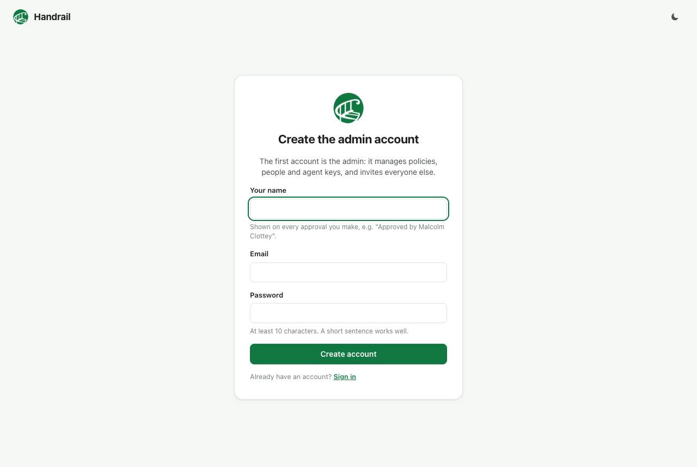 |
| Accept your invite | `/signup?invite=<token>`, valid token | 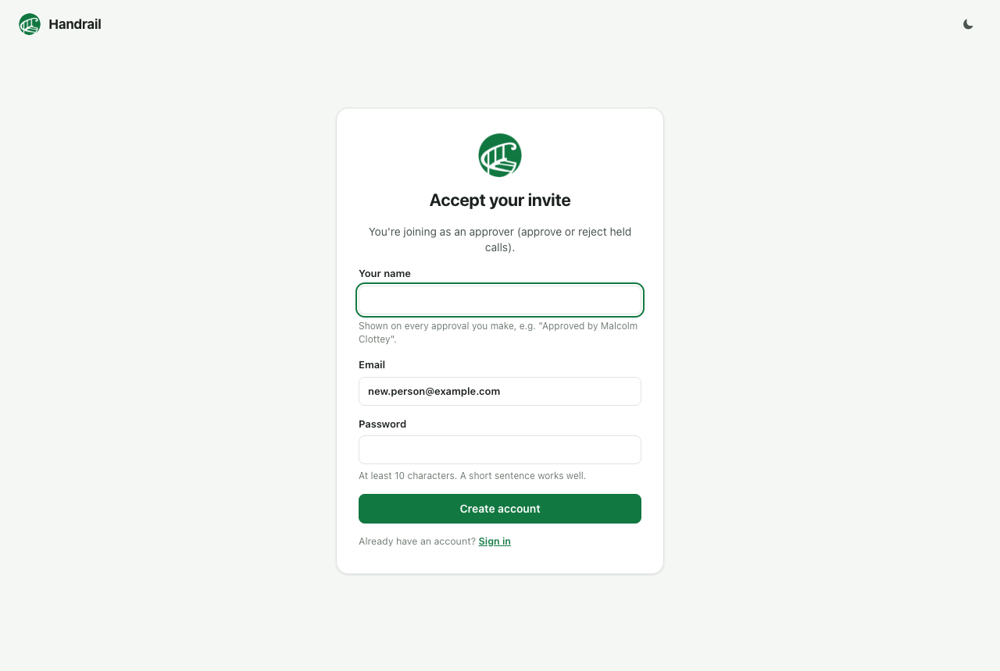 |
| Join Handrail (dead end) | `/signup` with no invite after setup | 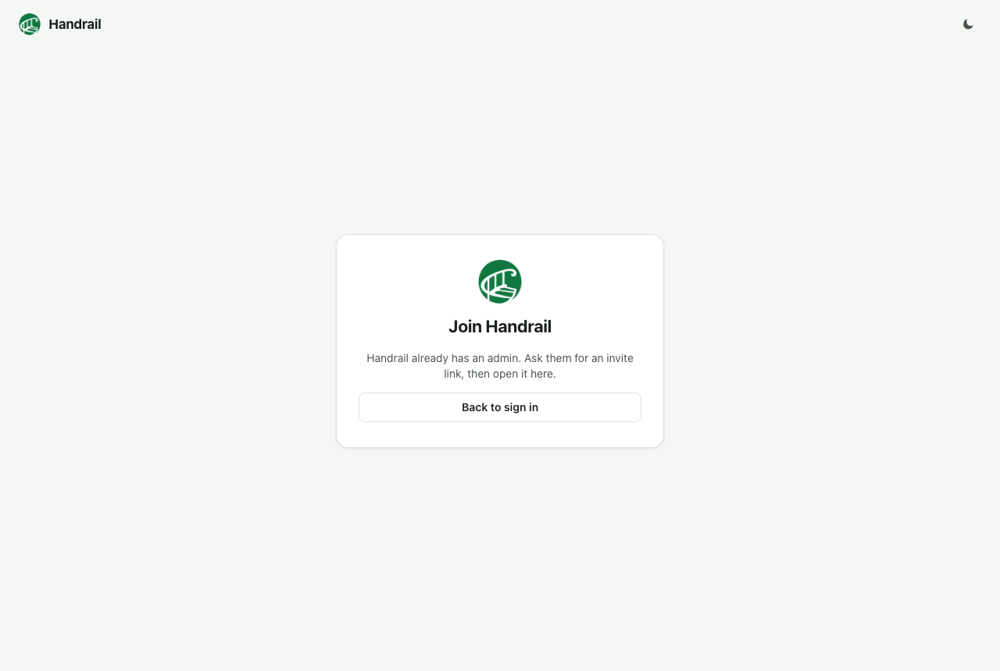 |

**Create the admin account**
- Title "Create the admin account". Lede: "The first account is the admin: it manages policies, people and agent keys, and invites everyone else."

**Accept your invite**
- Title "Accept your invite". Lede: "You're joining as an approver (approve or reject held calls)." The role words come from `ROLE_WORDS`; it reads "Checking your invite…" while loading.
- Email is prefilled and read-only.

**Invite not valid**
- Title "Invite not valid", the server's message as the lede, and a "Back to sign in" button.

**Join Handrail (dead end)**
- "Handrail already has an admin. Ask them for an invite link, then open it here." and a "Back to sign in" button.

**Form fields:**
- "Your name": required, autofocus. Hint: "Shown on every approval you make, e.g. "Approved by <name or Malcolm Clottey>"."
- "Email": type email, required.
- "Password": minlength 10, required. Hint: "At least 10 characters. A short sentence works well."

**Submit:** "Create account" ("Creating your account…" while busy). It's disabled while an invite is still loading.

**Errors** come from the server: invalid email, short password, "invite required", "email already used".

**Footer:** "Already have an account? Sign in".

---

## 3. Dashboard shell: `/app`

Shared by every tab. Screenshot (admin): [06-approvals-admin.png](ui-screens/06-approvals-admin.png).

**Order on the page**

1. **Top bar** (`.topbar`, white, bottom border):
   - Brand: logo, "Handrail" and a "SANDBOX" chip (amber). It links to `/`.
   - **Integrity badge** (pill button; click → Audit log tab):
     - "Checking audit log…", or "Audit log: can't check" on error.
     - "● Audit log intact", with meta in mono showing "<entries> entries · <head hash 8 chars>" (teal).
     - "Tampering detected (N)" (red, red border).
     - Tooltip: "Head hash <full>".
   - **Alerts chip** (pill link → #account):
     - "Alerts on: email + Slack" / "Alerts on: email" / "Alerts on: Slack" (teal)
     - "Alerts off" (grey, bordered)
     - "Alerts: preview only" (blue, demo)
     - The tooltip explains each state.
   - Right side ("who"):
     - User chip, linking to #account and outlined when Account is open: an avatar with initials, the name, and a role badge ("Admin"/"Approver"/"Viewer", uppercase).
     - Theme toggle.
     - "Sign out" (ghost button).
2. **Banners** (full width, under the top bar; any that apply):
   - Demo (green tint): "You're in your own demo workspace on PayPal's sandbox, signed in as an approver. No real money moves, and nobody else sees what you do here. Start with "Run demo agent" below."
   - Bypass (magenta, whole banner links to #activity): "PayPal reported N money-out action(s) in the last 30 days that didn't go through Handrail. Something may be bypassing it. See Activity, and check the Setup tab."
   - Connection (red): "Can't reach Handrail: <error>. Retrying…" (not shown for 401).
3. **Stats row**, six tiles with "–" until loaded:
   - "Waiting for approval": amber tile when above 0.
   - "Agent calls (24h)"
   - "Sent to PayPal"
   - "Blocked"
   - "Duplicates stopped"
   - "Webhook flags": magenta number when above 0.
4. **Tabs** (links with a hash, `role=tablist`):
   - Approvals, with an amber count badge when calls are waiting
   - Activity, Webhooks, Audit log, Policy, Setup
   - Team & keys (admins only)
   - There's no Account tab; it's reached through the user chip and the alerts chip.
5. **Main** (`.main`): the active tab.

**By role**
- Viewer and approver: no Team & keys tab, and `#team` falls back to Approvals.
- Demo: the demo banner, and the alerts chip reads "preview only".
- The other differences are inside the tabs.

---

## 4. Approvals tab: `#approvals` (default)

Admin: 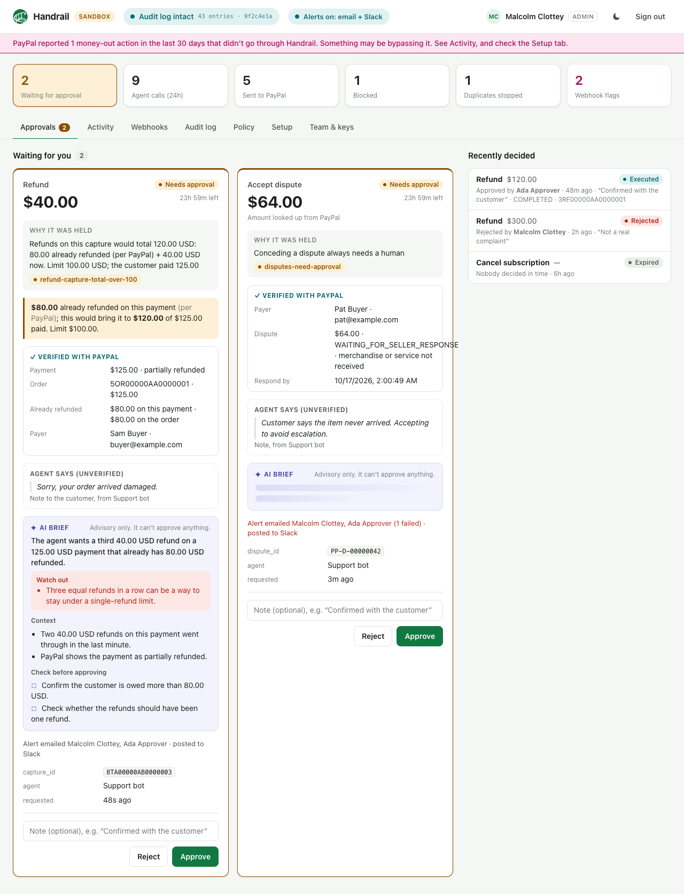 · Viewer: 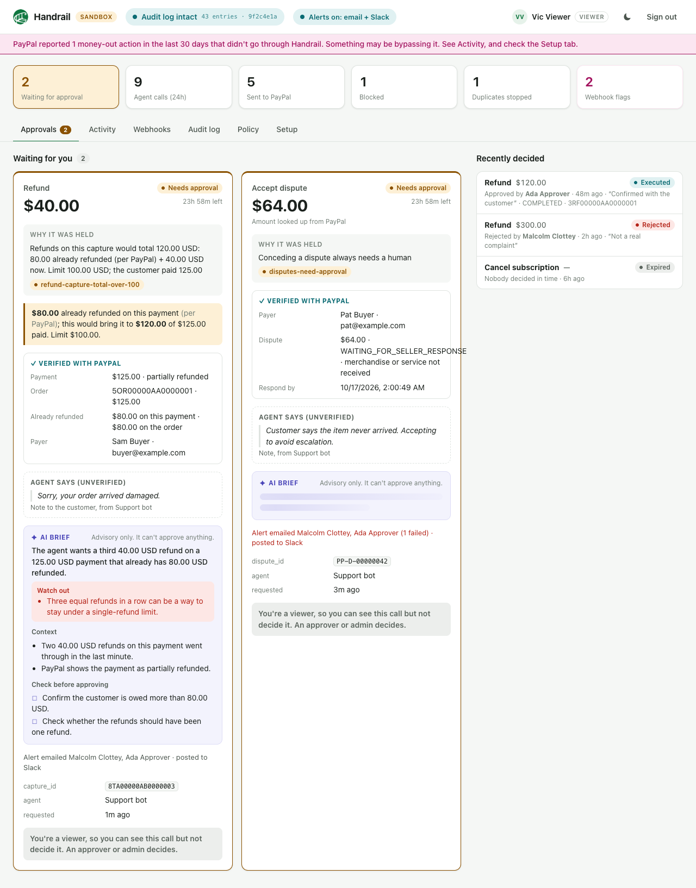 · Demo: 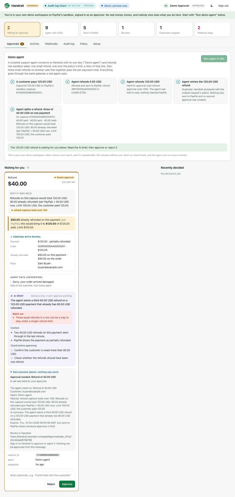 · Phone: 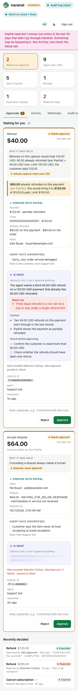

**Layout:** a two-column grid, with the main column on the left and a 280–380 px side column on the right. It collapses to one column under 1100 px.

1. **Demo agent panel**: demo account only, full width. See [§12](#12-demo-mode-differences).
2. **"From your alert" card**: full width, shown when the URL is `#approvals/<id>` and that approval isn't pending ([07-approval-link-decided.png](ui-screens/07-approval-link-decided.png)).
   - Kicker "From your alert", a status pill, then "<Tool> <amount>" in bold.
   - One sentence on what happened:
     - "Nobody decided in time, so it expired. It was not sent to PayPal."
     - "Approved by X 2h ago." / "Rejected by X 2h ago."
     - "This held call wasn't found. It may belong to another workspace, or the link is wrong."
   - A "Show everything waiting" ghost link to #approvals.
   - If the linked approval *is* pending, its card in the list gets a green outline and scrolls into view instead.
3. **"Waiting for you <count>"** (left column): approval cards in a grid, 1–2 per row by width.
   - Empty state: a dashed box, "Nothing to review" / "Calls that a policy holds for a human will appear here as they happen."
   - Load error: red text.
4. **"Recently decided"** (right column): a list of the last 15 decided approvals.
   - Each row: bold tool name, the amount ("—" when unknown), and a status pill: Executed (teal), Rejected (red), Expired (grey), Failed, Blocked.
   - Meta line: "Approved by <b>Name</b> · 48m ago · "note" · PayPal summary (e.g. "COMPLETED · <refund id>")", or "Nobody decided in time · 6h ago", or "No decision".
   - Empty state: "No decisions yet." (muted).

### 4.1 Approval card (`.approval-card`)

Sections, top to bottom:

| # | Section | Contents |
| --- | --- | --- |
| 1 | Header | Kicker = tool label ("Refund", "Accept dispute", "Cancel subscription"…). The amount is large (e.g. "$40.00"). Under it: "Amount looked up from PayPal" when it came from a lookup, or "No amount on this call" when there isn't one. Right side: a decision pill ("Needs approval", amber) and a countdown ("23h 59m left", "4:59 left" or "expired", turning red when expired). |
| 2 | Why it was held | Grey box. Label "WHY IT WAS HELD", the reason text, and a chip per rule that fired (amber, or red for block rules). |
| 3 | Running total | Only for `cumulative_limit` hits. Amber box with a left border: "**$80.00** already refunded on this payment (per PayPal); this would bring it to **$120.00** of $125.00 paid. Limit $100.00." There's one line per rule, and "plus $X held for approval" appears when other held refunds count. Scopes: "this payment / this order / this customer / this agent". |
| 4 | Verified with PayPal | Bordered box. "✓ VERIFIED WITH PAYPAL" (teal), with key–value rows when present:<br>• Payment: "$125.00 · partially refunded"<br>• Order: "<id> · $125.00"<br>• Already refunded: "$80.00 on this payment · $80.00 on the order"<br>• Payer: name · email · "VISA ending 1111"<br>• Dispute: amount · STATUS · reason, plus Respond by (date)<br>• Invoice and Subscription rows<br>On a failed lookup the label becomes "! COULDN'T VERIFY WITH PAYPAL" (amber border), with "<error>. The amount above is what the agent asked for; nothing else was confirmed." |
| 5 | Agent says (unverified) | Dashed box. "AGENT SAYS (UNVERIFIED)" (grey). Each claim is an italic blockquote, captioned "Note to the customer / Reason / Note, from <agent>". |
| 6 | AI brief | Indigo box. "✦ AI BRIEF" and "Advisory only. It can't approve anything." (tooltip: the model). States:<br>• **pending**: two shimmer bars<br>• **failed**: "Couldn't write a brief this time. The rule above is why it was held."<br>• **ready**: the summary; "Watch out" (red box with bullets, if there are concerns); "Context" (bullets); "Check before approving" (checkbox-style bullets)<br>• **unavailable** (AI off): hidden |
| 7 | Alert line | One line:<br>• "Alert emailed Malcolm Clottey, Ada Approver · posted to Slack" (normal)<br>• "Alert emailed … (1 failed) · posted to Slack" (red when partial or failed)<br>• "Alerts are off, so nobody was notified about this call." (grey)<br>• "Nobody was alerted: no approver has email alerts on."<br>• In a demo: a collapsible "▸ Alert preview (demo: nothing was sent)" showing the subject and plain-text email<br>• Hidden while there's no alert yet, or when it was skipped |
| 8 | Key–value list | The ids the call names (`capture_id`, `id`, `order_id`, `dispute_id`, `invoice_id`, `subscription_id`) in mono chips, then payee (if any), agent and "requested" (time ago). |
| 9 | Decision area | **Approver/admin:** a note input (placeholder "Note (optional), e.g. "Confirmed with the customer"", max 500) and buttons "Reject" (secondary) and "Approve" (primary). While busy they read "Rejecting…" / "Sending to PayPal…" and both are disabled.<br>**Viewer:** grey text "You're a viewer, so you can see this call but not decide it. An approver or admin decides."<br>**After deciding:** the outcome line replaces the buttons:<br>• "Approved and sent to PayPal: COMPLETED · <id>" (green)<br>• "Rejected. The agent was told no." (red)<br>• "Blocked on re-check: …" / "PayPal returned an error: …" (red)<br>• the server's error (e.g. "Approval … is expired, not pending")<br>The card stays about 2.5 s after a decision, then leaves the list. |

The card has an amber outline (`.approval-card` border in `--warn`). A focused card adds a 2 px green outline.

---

## 5. Activity tab: `#activity`

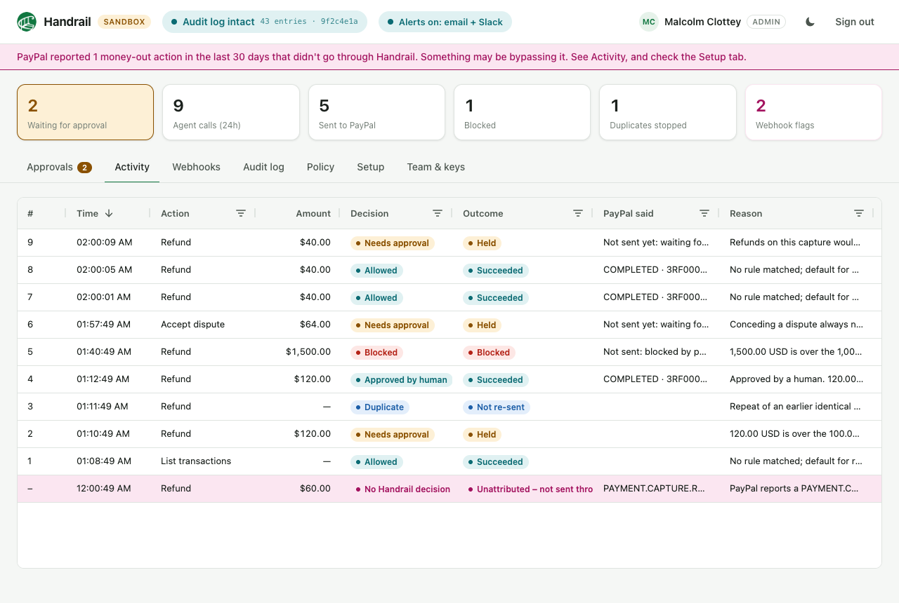 · Call drawer: 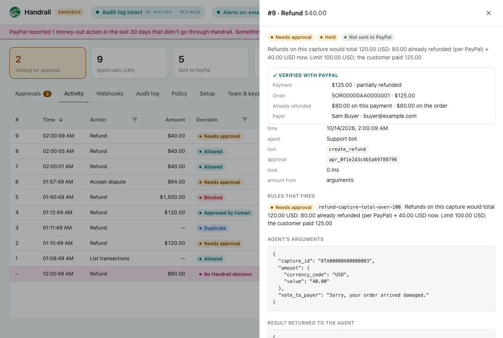 · Unattributed drawer: 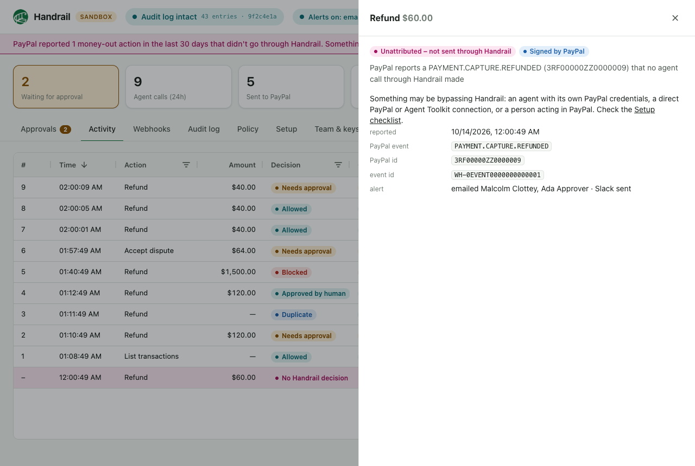

- **Contents:** a full-width AG Grid of the last 500 agent calls plus every "unattributed" PayPal action.
- **Live updates:** calls every 3 s, unattributed every 10 s.
- **Grid behaviour:**
  - Row click opens a drawer.
  - No pagination: it scrolls inside a fixed-height grid.
  - No export: no CSV module is registered.
  - Default sort is Time, newest first.
  - Every column is sortable and resizable. Columns with filters use AG Grid's default text filter, from the header icon.
  - Hover tooltip on Reason.
- **Rows:**
  - Unattributed rows have a magenta background (`.row-unattributed`).
  - Rows are clickable (`cursor: pointer`).
- **Empty overlay:** "No agent calls yet. Calls appear here as the agent makes them."
- **Loading:** AG Grid's loading overlay until the first response arrives.

| Column | Shows | Sort | Filter |
| --- | --- | --- | --- |
| # | Call id, or "–" for unattributed rows | ✓ | – |
| Time | Time today, or "Oct 12, 18:04" for older ones | ✓ (default desc) | – |
| Action | Tool label ("Refund", "List transactions") | ✓ | text |
| Amount | Currency formatted, right-aligned, "—" when unknown | ✓ (numeric) | – |
| Decision | Pill: Allowed, Needs approval, Blocked, Duplicate, "Approved by human" (a held call that was approved), or "No Handrail decision" (magenta, unattributed) | ✓ | text |
| Outcome | Pill: Succeeded, Failed, Unknown, Held, Expired, Blocked, "Not re-sent" (duplicate), "In flight" (null), or "Unattributed – not sent through Handrail" | ✓ | text |
| PayPal said | "COMPLETED · <id>", "Not sent yet: waiting for approval", "Not sent: blocked by policy", "PayPal error 404: …", or the event type + id for unattributed rows | ✓ | text |
| Reason | The engine's reason, or the unattributed reason (tooltip) | ✓ | text |
| Agent | Agent key name, "Local agent (stdio)", "–", or "Not through Handrail" | ✓ | text |
| PayPal-Request-Id | Mono; hidden under 1400 px viewport width | ✓ | – |

**Call drawer**, title "#9 · Refund $40.00":
1. Pills: the decision, the outcome, and "Sent to PayPal" (blue) or "Not sent to PayPal" (grey).
2. The reason paragraph.
3. A **Verified with PayPal** box (same component as the card) when the call has verified facts.
4. "Approved by **X** · "note"" / "Rejected by …", when a person decided.
5. Key–value list: time, agent ("Not recorded (before agent keys)" when missing), tool, PayPal-Request-Id, approval, took (ms), and "amount from" (arguments/lookup/none).
6. "RULES THAT FIRED": a pill, the rule id and the reason.
7. "AGENT'S ARGUMENTS": a JSON block.
8. "RESULT RETURNED TO THE AGENT": a JSON block. **[New]** When Handrail answered instead of PayPal (held, blocked, expired…), its first content block is the plain-words instruction for the model ("Not executed. Pending human approval (id …). Do not retry this call. …"), and the second is Handrail's JSON, whose `next_step` repeats the same text.
9. "AUDIT LOG ENTRIES": an ordered list of "#seq, kind, time, hash (16 chars)…". It shows "This call predates the audit log." when there are none.

**Unattributed drawer**, title "Refund $60.00":
1. Pills: "Unattributed – not sent through Handrail" (magenta), and "Signed by PayPal" (blue) or "Signature not verified" (amber).
2. The reason. Then: "Something may be bypassing Handrail: an agent with its own PayPal credentials, a direct PayPal or Agent Toolkit connection, or a person acting in PayPal. Check the Setup checklist." (The link goes to #setup.)
3. Key–value list:
   - reported, PayPal event, PayPal id, event id
   - alert: "emailed A, B · Slack sent", "Alerts are off", "Not alerted yet" or "Demo: shown as a preview, not sent"
4. "ALERT PREVIEW" text block (demo only).

---

## 6. Webhooks tab: `#webhooks`

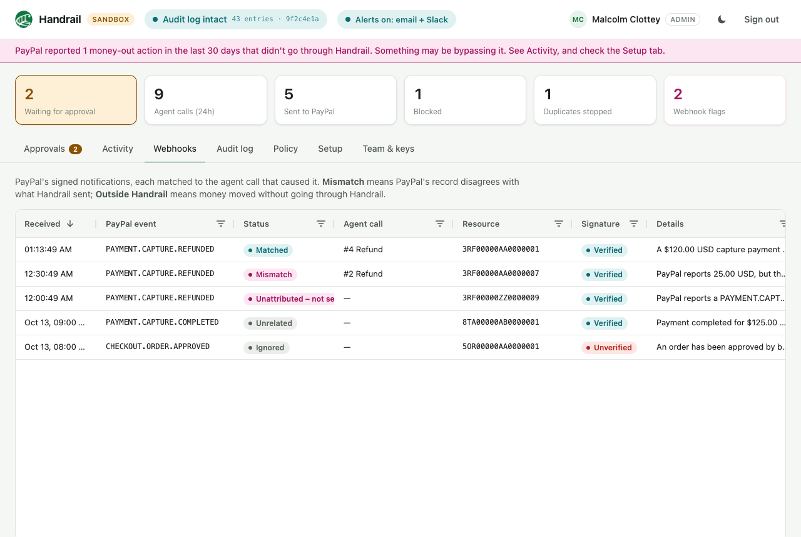

- **Lede:** "PayPal's signed notifications, each matched to the agent call that caused it. **Mismatch** means PayPal's record disagrees with what Handrail sent; **Outside Handrail** means money moved without going through Handrail."
- **Grid:**
  - Refreshes every 4 s. No row click, no drawer, no export, no pagination.
  - Empty overlay: "No webhooks received yet. Register /webhooks/paypal in the PayPal developer dashboard."

| Column | Shows | Sort/filter |
| --- | --- | --- |
| Received | Time (default sort desc) | sort |
| PayPal event | Event type, mono | sort + text |
| Status | Pill: Matched (teal), Mismatch (magenta), "Unattributed – not sent through Handrail" (magenta), Unrelated (grey), Ignored (grey) | sort + text |
| Agent call | "#4 Refund" or "—" | sort + text |
| Resource | PayPal id, mono | sort + text |
| Signature | "Verified" (teal) or "Unverified" (red) | sort + text |
| Details | Reasons joined with "; ", or PayPal's summary (tooltip) | sort + text |

---

## 7. Audit log tab: `#audit`

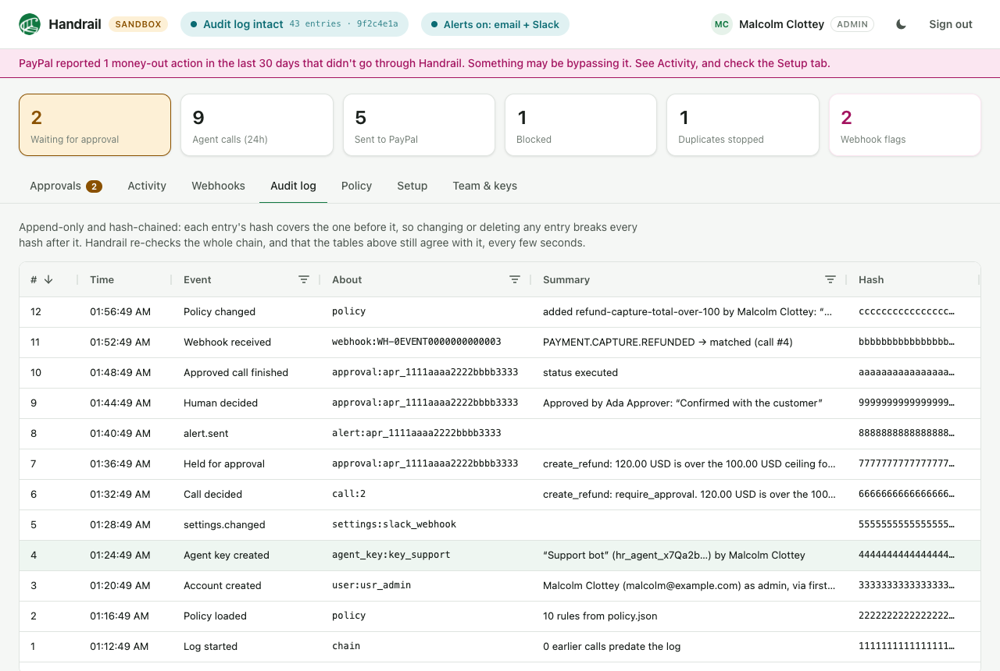 · Entry drawer: 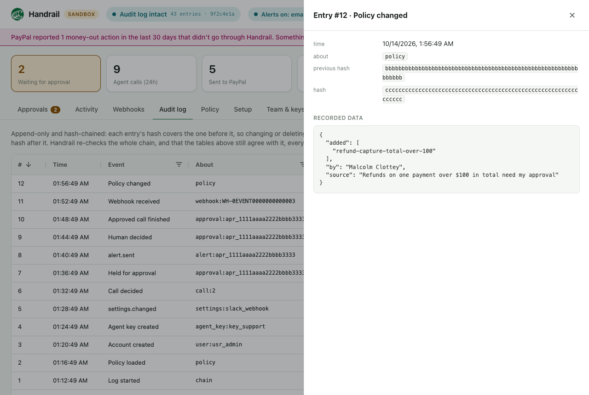

- **Lede:** "Append-only and hash-chained: each entry's hash covers the one before it, so changing or deleting any entry breaks every hash after it. Handrail re-checks the whole chain, and that the tables above still agree with it, every few seconds."
- **Tampering alert** (red box, only when verification fails): "**Tampering detected.**", followed by up to 8 problems ("#12 `call:3` tool_calls outcome differs from the audit log") and "…and N more".
- **Grid** of the last 1000 entries, refreshed every 4 s.
  - Rows that fail verification are red (`.row-broken`).
  - Row click opens the drawer.
  - Empty overlay: "The audit log is empty."

| Column | Shows | Sort/filter |
| --- | --- | --- |
| # | Sequence number (default sort desc) | sort |
| Time | Time | sort |
| Event | Friendly label: "Log started", "Call decided", "Duplicate stopped", "Call finished", "Held for approval", "Human decided", "Approved call finished", "Approval expired", "AI brief written", "Webhook received", "Policy loaded", "Policy changed", "Account created", "Account changed", "Invite sent", "Invite revoked", "Agent key created", "Agent key revoked". `alert.sent` and `settings.changed` have no label and show raw. | sort + text |
| About | Ref, mono (`call:9`, `approval:apr_…`, `webhook:…`, `policy`, `user:…`) | sort + text |
| Summary | One line per kind (e.g. "Approved by Ada Approver: "Confirmed with the customer"", "added X by Malcolm: "<English>""); blank for `alert.sent` and `settings.changed` | sort + text |
| Hash | First 16 chars + "…", mono | sort |

**Entry drawer**, title "Entry #9 · Human decided":
- Key–value list: time, about, previous hash, hash.
- "RECORDED DATA": a JSON block.

---

## 8. Policy tab: `#policy`

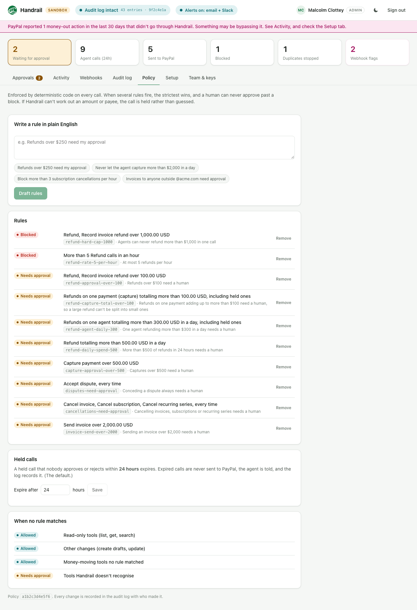 · With a drafted proposal: 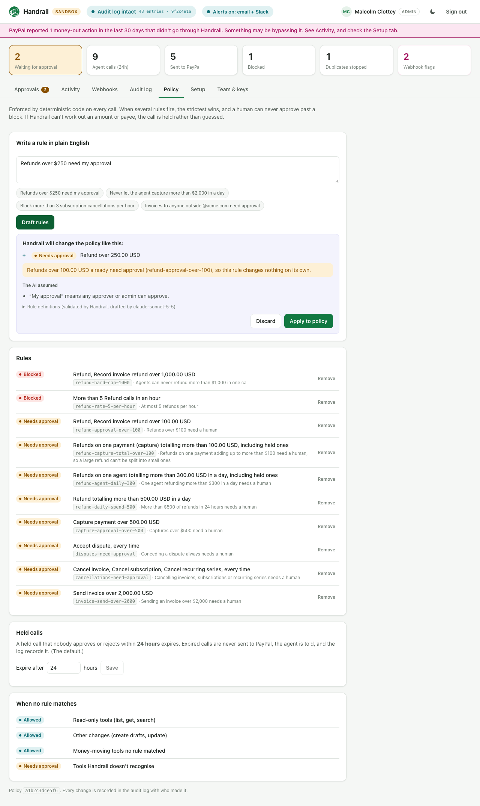

- **Lede:** "Enforced by deterministic code on every call. When several rules fire, the strictest wins, and a human can never approve past a block. If Handrail can't work out an amount or payee, the call is held rather than guessed."

**1. Composer** (admin only). Non-admins see the notice "Only admins can change the policy. You can see every rule that applies."

- **Title:** "Write a rule in plain English".
- **AI off:** "Set ANTHROPIC_API_KEY in .env and restart Handrail to draft rules in plain English."
- **Textarea:** max 1000, placeholder "e.g. Refunds over $250 need my approval". Cmd/Ctrl+Enter drafts.
- **Example chips** fill the textarea:
  - "Refunds over $250 need my approval"
  - "Never let the agent capture more than $2,000 in a day"
  - "Block more than 3 subscription cancellations per hour"
  - "Invoices to anyone outside @acme.com need approval"
- **"Draft rules" button** (primary; "Drafting…" while busy).
- **Clarifying question** (`.question`): "<question> Add the detail above and draft again."
- **Proposal box** (indigo tint):
  - "Handrail will change the policy like this:"
  - Change list: "+" with a decision pill and a sentence for each added rule; "−" with a sentence for each removed rule.
  - Warnings: amber box with bullets.
  - "The AI assumed": bullets.
  - Collapsible "▸ Rule definitions (validated by Handrail, drafted by <model>)", containing a JSON block.
  - Buttons "Discard" (secondary) and "Apply to policy" (primary; "Applying…").
- **After applying:** green "Applied: <sentences>". Errors (stale edit 409, invalid) show in red.

**2. Rules card**
- Title "Rules".
- One row per rule, strictest first: a decision pill (Blocked red, Needs approval amber, Allowed teal), the rule sentence ("Refunds on one payment (capture) totalling more than 100.00 USD, including held ones"), and meta: the rule id in mono · its description.
- Admins get a "Remove" ghost button per row, which asks via `window.confirm`: "Remove this rule?\n\n<sentence>\n\nThe change is recorded in the audit log."

**3. Held calls card**
- Title "Held calls".
- "A held call that nobody approves or rejects within **24 hours** expires. Expired calls are never sent to PayPal, the agent is told, and the log records it. (The default.)"
- Admin form: "Expire after [24] hours" (number, 1–720) and a "Save" button (secondary, disabled until changed).
- Validation: "Enter a number of hours from 1 to 720 (30 days)."
- Result: "Saved. Calls held from now on expire after N hours." or the error.

**4. "When no rule matches" card**
- Four rows: a decision pill plus one of "Read-only tools (list, get, search)", "Other changes (create drafts, update)", "Money-moving tools no rule matched", "Tools Handrail doesn't recognise".
- Read-only: there's no editor for these.

**5. Footer:** "Policy `<hash 12>`. Every change is recorded in the audit log with who made it."

---

## 9. Setup tab: `#setup`

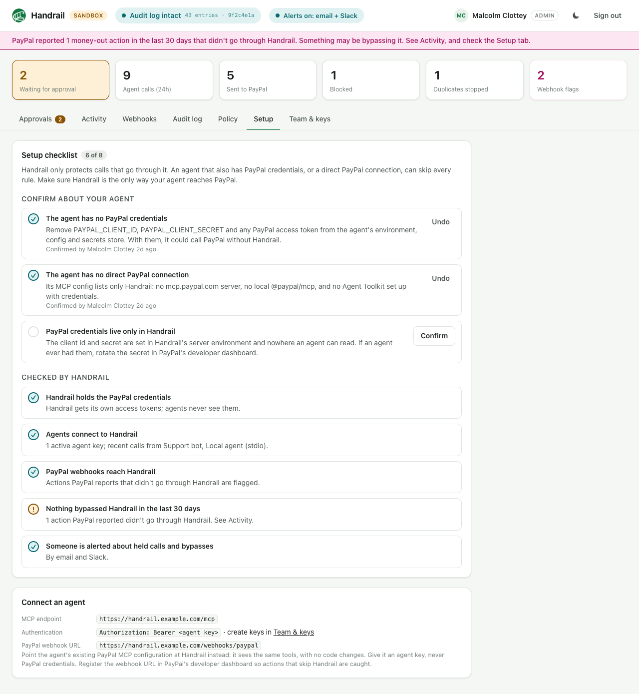

All roles see it; only admins can confirm items.

**Setup checklist card**
- Title "Setup checklist", with a count chip "N of 8".
- Help: "Handrail only protects calls that go through it. An agent that also has PayPal credentials, or a direct PayPal connection, can skip every rule. Make sure Handrail is the only way your agent reaches PayPal."

**"CONFIRM ABOUT YOUR AGENT"**: three manual items. Each row has a circle, a bold label, detail text, "Confirmed by X 2d ago" when confirmed, and an admin button "Confirm" (secondary) / "Undo" (ghost).
1. "The agent has no PayPal credentials"
2. "The agent has no direct PayPal connection"
3. "PayPal credentials live only in Handrail"

- Non-admins see: "Only an admin can confirm these. Confirmations are recorded in the audit log."

**"CHECKED BY HANDRAIL"**: five automatic items, ✓ teal or ! amber.
1. "Handrail holds the PayPal credentials"
2. "Agents connect to Handrail": "N active agent keys; recent calls from …"
3. "PayPal webhooks reach Handrail"
4. "Nothing bypassed Handrail in the last 30 days": or "N actions PayPal reported didn't go through Handrail. See Activity."
5. "Someone is alerted about held calls and bypasses"

**Connect an agent card**
- Key–value list:
  - MCP endpoint (mono URL)
  - Authentication: "`Authorization: Bearer <agent key>` · create keys in Team & keys" (admins) or "· an admin creates agent keys"
  - PayPal webhook URL (mono)
- Fine print: "Point the agent's existing PayPal MCP configuration at Handrail instead: …"

---

## 10. Team & keys tab: `#team` (admin only)

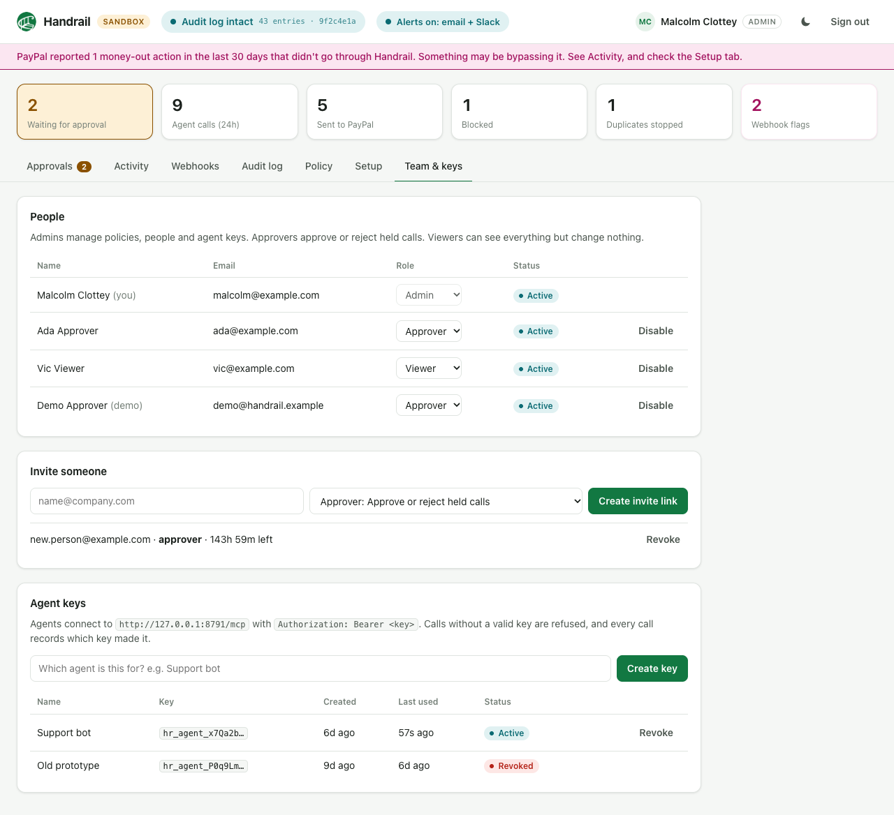

**People card**
- Help: "Admins manage policies, people and agent keys. Approvers approve or reject held calls. Viewers can see everything but change nothing."
- Table columns: Name ("(you)" and "(demo)" suffixes), Email, Role, Status, and an action.
  - Role: a select. It's disabled for yourself, and the demo account can't be made admin.
  - Status: a pill, Active (teal) or Disabled (grey).
  - Action: a "Disable"/"Enable" ghost button (not shown on yourself).
- Server errors show in red above the table (e.g. last admin).

**Invite someone card**
- Inline form:
  - Email: placeholder "name@company.com", required.
  - Role select: "Approver: Approve or reject held calls", "Viewer: Read-only", "Admin: Policies, people and agent keys".
  - "Create invite link" (primary).
- After creating, a **secret box**:
  - Title "Invite link for <email>"
  - A read-only input that selects on focus, and a "Copy" button that changes to "Copied"
  - "Send this link to them. It works once, for this email, for 7 days. It won't be shown again."
  - A "Done" button
- Open invites list: "email · **role** · 143h 59m left" with a "Revoke" ghost button.

**Agent keys card**
- Help: "Agents connect to `<origin>/mcp` with `Authorization: Bearer <key>`. Calls without a valid key are refused, and every call records which key made it."
- Form: a name input (placeholder "Which agent is this for? e.g. Support bot", max 80) and "Create key".
- After creating, a secret box: "Key for <name>", the key, Copy, and "Copy it now and store it in the agent's configuration. Handrail keeps only a hash, so it can't show it again."
- Empty state: "No agent keys yet", "Local agents that start Handrail over stdio don't need one."
- Table columns:
  - Name
  - Key prefix ("hr_agent_x7Qa2b…", mono)
  - Created and Last used (time ago, or "Never")
  - Status pill: Active or Revoked
  - "Revoke" ghost button, which confirms: "Revoke "<name>"? Agents using it are refused from now on. This can't be undone."

---

## 11. Account: `#account` (no tab; via the user chip or alerts chip)

Admin: 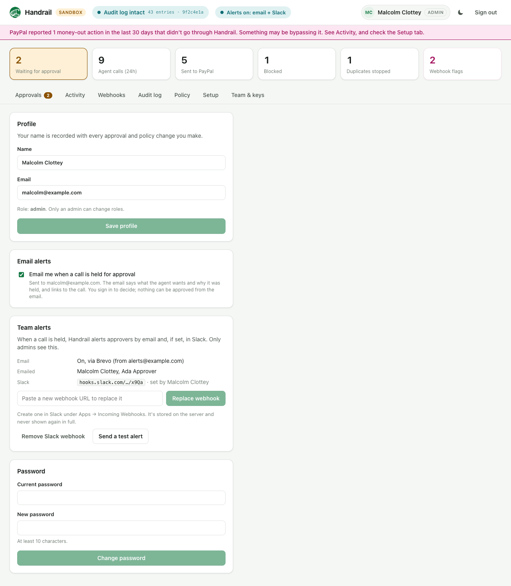 · Admin, alerts off: 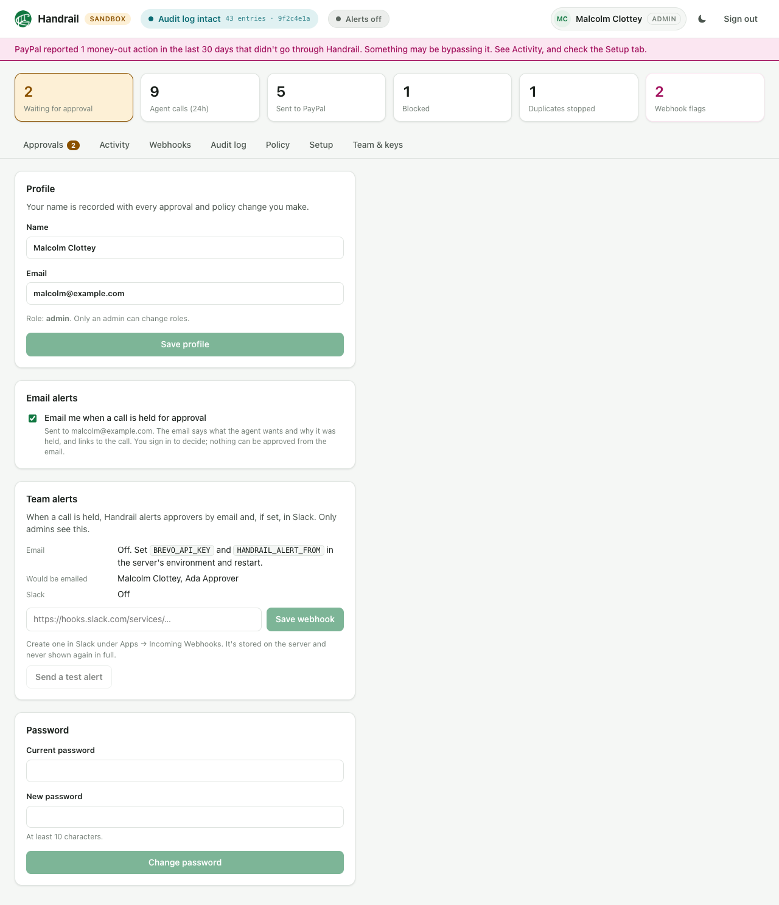 · Viewer: 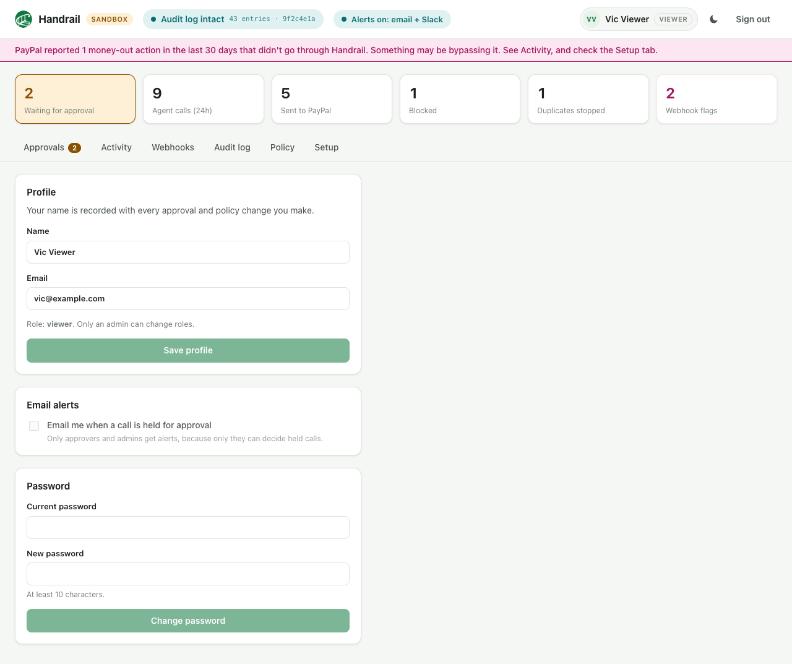 · Demo: 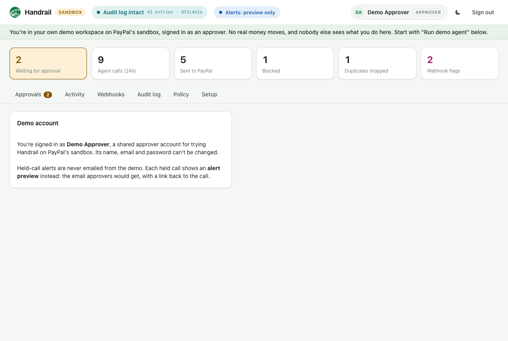

This is a single column of cards, 560 px wide.

**1. Profile**
- "Your name is recorded with every approval and policy change you make."
- Fields: Name (required, max 100) and Email (type email).
- "Role: **admin**. Only an admin can change roles."
- "Save profile" (disabled until something changes). Result: "Saved." or the error.

**2. Email alerts**
- A checkbox: "Email me when a call is held for approval".
- Hint for approvers and admins: "Sent to <email>. The email says what the agent wants and why it was held, and links to the call. You sign in to decide; nothing can be approved from the email."
- Viewers: the checkbox is disabled and unchecked, with "Only approvers and admins get alerts, because only they can decide held calls."
- Result line: "You'll get an email when a call is held." / "You won't get emails about held calls."

**3. Team alerts** (admin only)
- "When a call is held, Handrail alerts approvers by email and, if set, in Slack. Only admins see this."
- Key–value list:
  - Email: "On, via Brevo (from …)", or "Off. Set `BREVO_API_KEY` and `HANDRAIL_ALERT_FROM` in the server's environment and restart."
  - "Emailed" (or "Would be emailed" when email is off): names, or "Nobody: no approver or admin has email alerts on."
  - Slack: the masked URL "`hooks.slack.com/…/x9Qa` · set by X", or "Off".
- Form:
  - URL input (type url), placeholder "https://hooks.slack.com/services/…", or "Paste a new webhook URL to replace it" when one is set.
  - Button "Save webhook" / "Replace webhook".
- Fine print: "Create one in Slack under Apps → Incoming Webhooks. It's stored on the server and never shown again in full."
- Buttons:
  - "Remove Slack webhook" (ghost; confirms "Remove the Slack webhook? Held calls will no longer be posted to Slack.")
  - "Send a test alert" (secondary; disabled when nothing is configured)
- Results: "Slack webhook saved. Held calls will be posted there.", "Slack webhook removed.", "Test alert: email sent to …; Slack sent.", or a server error such as "Use a Slack incoming webhook URL: https://hooks.slack.com/services/…".

**4. Password**
- Fields: Current password, and New password (minlength 10, hint "At least 10 characters.").
- "Change password" (disabled until valid).
- Result: "Password changed. Other devices have been signed out." or an error such as "Your current password is wrong."

**Demo account** (one card only)
- Title "Demo account".
- "You're signed in as **Demo Approver**, a shared approver account for trying Handrail on PayPal's sandbox. Its name, email and password can't be changed."
- "Held-call alerts are never emailed from the demo. Each held call shows an **alert preview** instead: the email approvers would get, with a link back to the call."

---

## 12. Demo-mode differences

Demo accounts are entered only through "Try the demo" (Home or Sign in) and are approvers in their own throwaway workspace.

- **Header:** the demo banner, and "Alerts: preview only" (blue).
- **Tabs:** like an approver's, with no Team & keys.
- **Approvals:** a **Demo agent panel** spans both columns above the cards ([20-demo-approvals.png](ui-screens/20-demo-approvals.png)):
  - Title "Demo agent", with help text: "A scripted support agent connects to Handrail with its own key ("Demo agent") and refunds real sandbox sales: one small refund, one over the policy's limit, a retry of that one, then three small refunds on another sale that together pass the per-payment total. Everything goes through the same gateway a real agent uses."
  - Button (primary, top right): "Run demo agent" → "Starting…" → "Agent running…" (disabled) → "Run again in 38s" (countdown, disabled) → "Run demo agent again".
  - Steps: a 4-column card grid (one column under 900 px). Each step has an icon (spinner while running, ✓ done, ! unexpected, ✕ failed, blank while waiting), a title, and the expected text, which the actual outcome replaces:
    1. "A customer pays 125.00 USD": "Captured 125.00 USD on PayPal's sandbox (capture …)."
    2. "Agent refunds 5.00 USD": "Allowed and sent to PayPal: refund … is COMPLETED."
    3. "Agent refunds 120.00 USD": "Held for approval (rule refund-approval-over-100). The agent was told to wait; nothing reached PayPal."
    4. "Agent retries the 120.00 USD refund": "Duplicate: Handrail answered with the original request's status. Nothing was sent to PayPal and no second approval was created."
    5. "Agent splits a refund: three of 40.00 USD on one payment": "On capture …: 40.00 sent · 40.00 sent · 40.00 held: Refunds on this capture would total 120.00 USD …". If the policy has no per-capture total, the step reads "Skipped: …".
  - Notices under the steps:
    - "The 120.00 USD refund is waiting for you below. Read the AI brief, then approve or reject it." (+ "The agent is waiting too, and will retry while it does.")
    - "<name> approved the 120.00 USD refund and Handrail sent it to PayPal once, although the agent asked twice. See the Activity and Audit log tabs for the record."
    - "<name> rejected the 120.00 USD refund. The agent was told no, and PayPal never saw it."
    - "The demo agent stopped: <error>" (red)
    - Server errors such as rate limits ("The demo agent can run once a minute. Try again in N seconds.") in red.
  - Fine print: "This is your own demo workspace: other visitors can't see it, and it's cleared after 120 minutes without use. Each run starts fresh, and the agent can run once a minute."
- **Approval cards:** the alert line is a collapsible **alert preview** with the subject and full email text.
- **Setup:** manual items are never shown as confirmed (the real deployment's confirmations are hidden). Viewers and the demo account see no Confirm buttons.
- **Account:** only the "Demo account" card.
- **Data:** every tab shows only that session's workspace.

---

## 13. Responsive behaviour

Breakpoints are in `styles.css`.

| Width | Changes |
| --- | --- |
| ≤ 1400 px (viewport, in JS) | Activity hides the PayPal-Request-Id column. |
| ≤ 1100 px | Stats go from 6 to 3 columns. Approvals goes to one column, with "Recently decided" moving below the cards. |
| ≤ 900 px | Home hero goes to one column (the card drops below the copy); problem tiles and steps go to one column. **[New]** The feature cards and the two "Works with the agent you have" cards go to one column, and the framework tabs wrap. Demo steps go to one column, and the demo panel header stacks (button under the text). |
| ≤ 640 px | **Dashboard:** the top bar wraps; integrity meta (entries · hash) is hidden; the user's name and role badge are hidden (initials only); stats go to 2 columns; tabs scroll sideways (`overflow-x: auto`, no fade or indicator, so the last tabs are cut off — see [22-phone-approvals.png](ui-screens/22-phone-approvals.png)); main padding goes to 16 px; cards go to one column; key–value rows stack (label above value); policy rules stack; the alerts chip gets smaller. **Home:** the nav links "The problem" and "How it works" are hidden, with 16 px gutters. **Auth pages:** the top bar uses 16 px gutters. **Team:** the secret box stacks its input and Copy button. **Setup:** checklist buttons move under the text. |
| Drawers | Width is `min(620px, 100%)`, so full width on phones. |
| Grids | AG Grid keeps its columns; on phones the grids scroll sideways inside their container. |

There's no hamburger menu and no bottom navigation, and nothing besides the PayPal-Request-Id column hides at a breakpoint.

---

## 14. Light and dark mode

- **Light is the default**. The toggle (☾ in light, ☀ in dark) appears in every header: Home nav, auth top bar and dashboard top bar.
- The choice is saved in `localStorage` and applied before first paint (inline script in `index.html`). `prefers-color-scheme` is ignored.
- Dark mode redefines every color token (see [§16](#16-design-tokens-in-use)):
  - Brand green turns lighter (#64c48a), and text on brand buttons becomes near-black (#0d130f) instead of white.
  - `--shadow` becomes `none`, so cards rely on borders.
  - Status colours turn into light-on-dark pastels.
  - AG Grid switches to `colorSchemeDark` with matching hex values in `grid.ts`.
- The logo PNG is the same in both modes (a green circle with a transparent outside).
- Comparison screenshot: [24-dark-approvals-for-comparison.png](ui-screens/24-dark-approvals-for-comparison.png).

---

## 15. Navigation map

```
/ (Home)
├── #problem, #features, #connect ... nav anchors  ([New] #features, #connect)
├── #how .......................... section without a nav link ([New] link removed)
├── Framework tabs ................ LangChain (Python) / CrewAI / Vercel AI SDK / LangChain JS ([New], in-page)
├── Try the demo ───────────────────────────────┐ (demo access on)
├── Sign in / Set up Handrail → /login or /signup
│
/login
├── Create the admin account → /signup (setup only)
├── Try the demo ───────────────────────────────┤
└── (signed in) → /app or ?next=/app#approvals/<id>
│
/signup                     (first admin | ?invite=<token> | dead end)
├── Sign in / Back to sign in → /login
└── (account created) → /app
│
/app  ◄─────────────────────────────────────────┘  (signed out → /login?next=…)
├── Logo → /
├── Audit badge → #audit
├── Alerts chip → #account
├── User chip → #account
├── Sign out → /
├── Bypass banner → #activity
└── Tabs
    ├── #approvals (default) ── #approvals/<id> (from alert emails)
    │     └── "Show everything waiting" → #approvals
    ├── #activity ── call drawer | unattributed drawer → "Setup checklist" → #setup
    ├── #webhooks
    ├── #audit ── entry drawer
    ├── #policy
    ├── #setup ── "Team & keys" link → #team (admin)
    ├── #team (admin only)
    └── #account (no tab)
```

---

## 16. Design tokens in use

### Colors (`:root`, light → `[data-theme="dark"]`)

| Token | Light | Dark | Used for |
| --- | --- | --- | --- |
| `--brand` | #127842 | #64c48a | Primary buttons, links in kicker, step numbers, focus outline on focused card, tab underline (`--accent`), hero card top border, toggle accent |
| `--brand-hover` | #0d5f33 | #85d3a5 | Primary button hover/pressed |
| `--brand-tint` | #e6f2ea | #1a2b20 | Demo banner, notices, user chip hover, selected rows |
| `--brand-tint-2` | #cce5d5 | #1f3b29 | Borders of tinted boxes, spinner track |
| `--on-brand` | #ffffff | #0d130f | Text on primary buttons |
| `--focus` | #127842 | #85d3a5 | Focus rings |
| `--white` | #ffffff | (same) | Logo fallback strokes |
| `--bg` | #f5f7f5 | #0f1311 | Page background |
| `--surface` | #ffffff | #151a17 | Cards, top bar, drawers |
| `--surface-2` | #f5f7f5 | #1b211d | Mono chips, "why" boxes, alert preview, problem tiles |
| `--ink` | #1b211d | #e5ebe6 | Body text |
| `--ink-2` | #4b554e | #b4beb6 | Secondary text |
| `--ink-3` | #737e76 | #87918a | Muted text, h3 labels |
| `--line` | #dfe4e0 | #2a332d | Borders and dividers |
| `--ai` / `--ai-bg` / `--ai-line` | #4a45b8 / #f3f3fd / #dddcf6 | #b3b0ff / #1b1b30 / #302f55 | AI brief, policy proposal box |
| `--accent`, `--accent-hover` | aliases of brand | | Tab underline, a few buttons ("older names") |
| `--logo-ink` | = `--white` | | Defined but never used |

### Status colors (always paired with a text label)

| Status | Text / bg (light) | Text / bg (dark) | Meaning |
| --- | --- | --- | --- |
| good (teal) | #0b6b73 / #e0f1f2 | #6fd0d6 / #10292b | Allowed, Succeeded, Executed, Active, Matched, Verified, audit intact, "Verified with PayPal" |
| warn (amber) | #8a5100 / #fdf0d6 | #f3b955 / #362810 | Needs approval, Held, waiting stat, running totals, approval card border, "Couldn't verify", SANDBOX chip |
| bad (red) | #b42318 / #fde7e5 | #ff8a80 / #3a1714 | Blocked, Rejected, Failed, Revoked, Unverified, errors, tampering |
| flag (magenta) | #a3135f / #fbe6f1 | #f48cc0 / #351426 | Mismatch, Unattributed, bypass banner, webhook-flag stat |
| info (blue) | #1d5fa8 / #e3eefb | #8ab8f0 / #142740 | Duplicate, In flight, Sending, "Sent to PayPal", alerts preview chip |
| muted (grey) | #5b655e / #eceeec | #a3ada5 / #232a25 | Expired, Unrelated, Ignored, Disabled, Alerts off |

AG Grid (`grid.ts`):
- Light: accent #127842, background #ffffff, foreground #1b211d, border #dfe4e0, header bg #f5f7f5, header text #4b554e, row hover #eef6f1, selected row #e0efe5.
- Dark: accent #64c48a, background #151a17, foreground #e5ebe6, border #2a332d, header bg #1b211d, header text #b4beb6, row hover #1a2b20, selected row #1e3627.
- Both: font inherited, 13 px, header weight 600, radius 6, wrapper radius 10, spacing 7.

The alert email (HTML) hard-codes #127842 for its button and #56605a for labels.

**[New] Homepage code blocks** use tokens only: `--surface-2` background, `--mono` at 12.5 px with line-height 1.6. Added diff lines are `--brand` on `--brand-tint`, removed ones `--bad` on `--bad-bg`. The selected framework tab is `--brand` with `--on-brand` text. Feature icon tiles are `--brand` on `--brand-tint`.

### Typography
- **Families:**
  - `--font`: ui-sans-serif, system-ui, -apple-system, "Segoe UI", Roboto, "Helvetica Neue", sans-serif.
  - `--mono`: ui-monospace, "SF Mono", SFMono-Regular, Menlo, Consolas, monospace.
  - No web fonts are loaded.
- **Base:** 14 px with line-height 1.45.
- **Sizes in use** (count): 12 px (26), 13 px (10), 11 px (5), 14 px (4), 12.5 px (3), 16 px (3), 17 px (3), 15 px (2), 18 px, 22 px, 24 px, 28 px, 30 px, and `clamp(32px, 4.6vw, 50px)` for the home H1.
- **Weights:** 600 (22), 700 (11), 500 (7), 650 (3), 400 (2).
- **Labels:**
  - `h3` is 12 px uppercase, 0.04em tracking, `--ink-3`.
  - Card section labels ("WHY IT WAS HELD", "VERIFIED WITH PAYPAL", "AGENT SAYS", "AI BRIEF") are 12 px, 700, uppercase.

### Spacing, radii, shadows
- **Gaps** most used: 8 px (17), 10 (14), 6 (12), 12 (8), 16 (5), 14 (4), 2 (4), 20 (3), 28 (2), plus 36 and 56 on Home.
- **Padding:**
  - Most common: 10/12 px (boxes) and 18 px (cards).
  - Top bar 12/24, main 24 (16 on phones), home sections 56/32.
- **Radii:**
  - `--radius` 12 px for cards (5 uses); 10 px (10) for inner boxes; 8 px (9) for buttons and inputs; 999 px (9) for pills and chips; 50% (10) for avatars, dots and checks; 16 px (2) on Home; 6 and 5 px for mono chips.
  - Plus `0 8px 8px 0` on the running-total box.
- **Shadows:**
  - `--shadow` = `0 1px 2px rgb(16 24 20 / .05), 0 1px 3px rgb(16 24 20 / .06)` on cards and stats (none in dark).
  - The hero card has its own larger shadow: `0 12px 32px …, 0 2px 6px …`.
- **Motion:** spinner and shimmer animations, both turned off under `prefers-reduced-motion`.

---

## 17. Shared components

| Component | File | Where it appears |
| --- | --- | --- |
| `Logo` (PNG with SVG fallback) | components.tsx | Home nav, auth top bar, auth card (56 px), dashboard top bar |
| `ThemeToggle` | components.tsx | Home nav, auth top bar, dashboard top bar |
| `Pill` | components.tsx | Everywhere a status or tone is shown |
| `DecisionPill` (allow/approved/require_approval/block/duplicate) | components.tsx | Approval cards, Activity grid and drawer, Policy rules, policy proposal, defaults list |
| `StatusPill` (outcomes, approval statuses, webhook statuses) | components.tsx | Activity grid/drawer, Webhooks grid, Recently decided, focused-approval card, unattributed drawer |
| `Mono` (inline code chip) | components.tsx | Ids, hashes, URLs, env var names, rule ids |
| `JsonBlock` | components.tsx | Activity drawer (args, result), Audit drawer, policy proposal definitions |
| `Empty` (dashed empty state) | components.tsx | Approvals ("Nothing to review"), agent keys ("No agent keys yet") |
| `Drawer` | components.tsx | Activity call, Activity unattributed, Audit entry |
| `usePoll`, `useNow` | components.tsx | Every view (polling), approvals/countdowns (ticking clock) |
| `Verified` | views/Approvals.tsx (exported) | Approval cards, Activity call drawer |
| `AiBrief`, `RunningTotals`, `AgentSays`, `AlertLine`, `ApprovalCard`, `FocusedApproval` | views/Approvals.tsx | Approvals tab only |
| `DemoAgentPanel` | views/DemoAgent.tsx | Approvals tab, demo account only |
| `SecretBox` | views/Team.tsx | Invite link and new agent key (Team & keys) |
| `AuthShell` | views/AuthPages.tsx | Sign in, Sign up variants |
| `HeroCard` | views/Home.tsx | Home hero only |
| **[New]** `FrameworkDiffs` (tabs + diff block), `FEATURES`, `MCP_SNIPPET` | views/Home.tsx | Home "Works with the agent you have" and "What Handrail does" |
| **[New]** `.feature`, `.feature-icon`, `.connect-card`, `.code`, `.code-diff` (`.add`/`.del`), `.diff-tab` (CSS patterns) | styles.css | Homepage only so far |
| `Stat`, `IntegrityBadge`, `AlertsChip` | App.tsx | Dashboard shell |
| AG Grid + `useGridTheme` | grid.ts | Activity, Webhooks, Audit log |
| `.kv` key–value list (CSS pattern) | styles.css | Approval cards, drawers, Setup, Team alerts |
| `.card`, `.section-title`, `.section-help`, `.notice`, `.outcome-*`, `.error`, `.fine` (CSS patterns) | styles.css | All dashboard views |

---

## 18. Inconsistencies noticed

Listed as found, not fixed.

**Wording and labels**
1. **"Outside Handrail" and "Unattributed" both name the same status.** The Webhooks lede says "**Outside Handrail** means money moved without going through Handrail", but the pill everywhere now reads "Unattributed – not sent through Handrail". The status key in the data is still `outside_handrail`.
2. **The audit log has no labels for two event kinds.** `alert.sent` and `settings.changed` show their raw keys in the Event column, and their Summary is blank ([12-audit.png](ui-screens/12-audit.png)).
3. **Two money formats.** Server-written reasons use "120.00 USD", while the card amounts, running totals and verified rows use the browser's currency format ("$120.00"). Both appear in the same card: "Why it was held" says "120.00 USD", and the total box says "$120.00". The Home hero card uses "250.00 USD".
4. **Raw PayPal enums.** The dispute status shows unformatted ("WAITING_FOR_SELLER_RESPONSE") and overflows the card on desktop ([06](ui-screens/06-approvals-admin.png)). The dispute reason and capture status are lower-cased and de-underscored, so the same card mixes both styles.
5. **Snake-case ids next to plain English labels.** Cards and drawers show argument keys as-is (`capture_id`, `dispute_id`, "amount from") next to labels like "Payment" and "Already refunded".
6. **Rule sentences say "Refund, Record invoice refund over…".** The tool labels are listed with commas and title case mid-sentence. Cumulative rules read differently ("Refunds on one payment (capture) totalling…").
7. **Invite countdowns show hours.** For example "143h 59m left" for a 7-day invite. The format was written for approval countdowns.
8. **Decision words vary.** "Needs approval" (pill) vs "Held" (outcome) vs "Waiting for approval" (stat) vs "pending_approval" ("Not sent yet: waiting for approval") are all in use. The Activity Decision column also invents "Approved by human" and "No Handrail decision", which don't appear anywhere else.

**Stats and navigation**

9. **Two different flags under one number.** The "Webhook flags" stat counts mismatches and unattributed actions together, while the bypass banner counts only unattributed ones (last 30 days vs all time).
10. **The summary's `expired` count is never shown.** The API returns it (`last24h.expired`), but there's no stat tile for it.
11. **Account has no tab.** It's reached only through the user chip or the alerts chip, unlike every other section.

**Interaction patterns**

12. **Webhooks rows don't open.** Activity and Audit log rows open a drawer; Webhooks rows don't, so there's no way to see a webhook's raw event in the UI.
13. **Mixed feedback patterns.** Destructive actions use native `confirm()`/`alert()` dialogs while everything else uses inline styled feedback, and there are no toasts.
14. **Theme handling differs.** The UI ignores `prefers-color-scheme`, though the token file is set up to support it.
15. **Phone tabs are cut off with no hint.** At phone width the tab bar scrolls sideways with no fade or indicator ([22](ui-screens/22-phone-approvals.png)).
16. **Grids differ from each other.** None has pagination or export. Activity caps at 500 calls and Audit at 1000 entries, with no "load more" and no note that older rows are hidden.
17. **Similar boxes repeat.** The card stacks seven bordered or tinted boxes ("why", running total, verified, agent says, AI brief, alert preview), each with its own border style: solid grey fill, amber left border, solid border, dashed border, indigo fill, dashed fill. A held card is very long, especially on phones.

**Visual system**

18. **Two greens and a teal.** The brand green (#127842) is used for buttons, while the "good" status is a deliberately different teal (#0b6b73). The "Verified with PayPal" label uses teal, while the Setup ✓ marks and Active pills also use teal. The approved/executed meaning is spread across teal pills and green buttons.
19. **Uneven type scale.** It has 14 distinct font sizes, including 12.5 px, 17 px and a 650 weight, with no named type tokens.
20. **Radii and spacing are ad hoc.** `--radius` (12 px) is used only 5 times; other radii are literal (10, 8, 6, 5, 16). Spacing values are literal pixels (2–56) with no scale.
21. **Unused or duplicate tokens and classes.** `--logo-ink` is defined but never used. `--accent` and `--accent-hover` duplicate `--brand` ("older names, kept for existing rules"). `.stat-bad` is styled but no stat uses the "bad" tone.

**Types and data**

22. **Type drift.** `DemoStatus.plan` in `web/src/api.ts` has no `split` field, although the server sends it.
23. **Real-world identity mixes.** The People table offers a role select for the demo account, while the demo's own Account page says nothing about it can change. The demo account also appears in the real team's People list.
24. **Spacing glitch.** In the Activity call drawer, the "Verified with PayPal" box sits directly against the key–value list below it, with no gap ([09](ui-screens/09-activity-call-drawer.png)).
25. **The agent keys help shows the browser's origin.** It uses `location.origin` for the MCP URL, while the Setup tab shows the server's configured public URL. Behind a proxy or a different host, the two can differ.

**[New] Homepage**

26. **Messaging repeats three times.** The problem tiles, the "How it works" steps and the new feature cards repeat each other: retries are covered in all three, and the record in two.
27. **"How it works" has no nav link.** The nav now links "What it does" and "Connect your agent", but not "How it works", which still sits between them on the page.
28. **Two kinds of MCP config.** The homepage shows an HTTP config (`url` + `headers`), while the README shows a stdio one (`command`/`args`). Neither says which MCP clients accept which shape.
29. **The homepage diffs are abbreviated.** They use short forms (`{ clientId, clientSecret, … }`, `Agent(role=…, …)`) that differ from the full diffs of PayPal's examples in the README.
30. **Wide code is cut off on desktop.** Code blocks scroll sideways, so on a 1280 px screen the long import and constructor lines are cut mid-line, with nothing to say there's more ([01b](ui-screens/01b-home-connect-ai-sdk-tab.png)).
31. **Ad hoc icons.** Feature icons are text glyphs (Σ ✓ ! ✉ 1× #) in tinted tiles; the dashboard has no icon set. "✓" and "!" also mean "checked" and "needs attention" in the Setup checklist.
32. **Hero vs. cards.** The hero card still shows the old money format ("250.00 USD") and no "Verified with PayPal" or "Agent says" sections, so it no longer looks like a real approval card (compare [06](ui-screens/06-approvals-admin.png)).
33. **The agent's result appears in two forms.** In the Activity drawer, "Result returned to the agent" shows the raw result: a plain-text block, then a JSON string inside JSON. The plain-words instruction appears twice (as `text` and as `next_step`).
